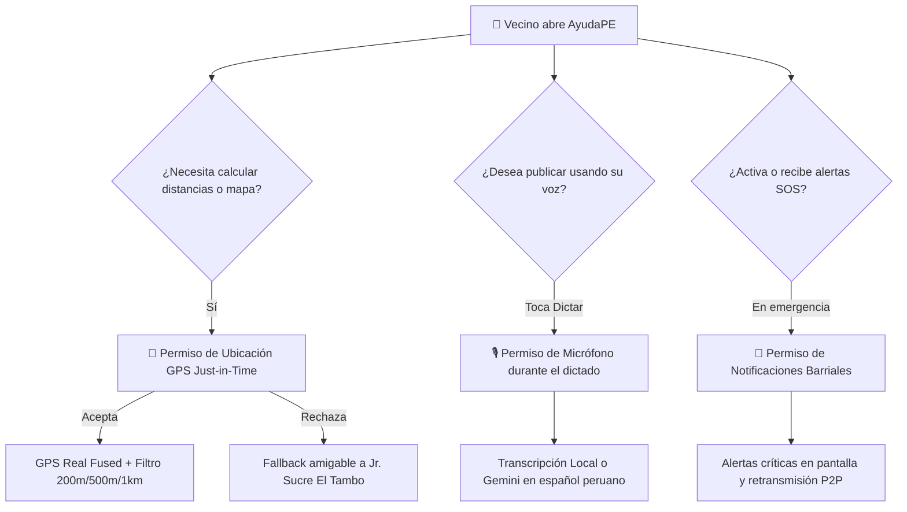
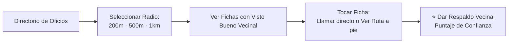
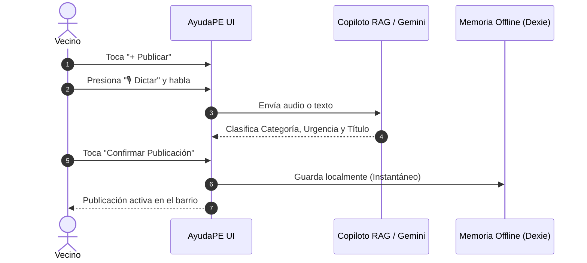
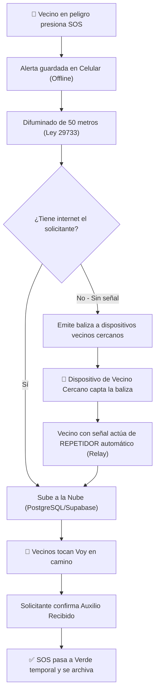

# 🦙 AyudaPE — Manual de Usuario y Guía de Resiliencia Barrial
> **Plataforma Hiperlocal Comunitaria y Resiliente ante Emergencias (Huancayo, Perú)**  
> **Despliegue en Vivo:** [https://hackaton-rho-six.vercel.app](https://hackaton-rho-six.vercel.app)  
> **Repositorio Oficial:** [https://github.com/xthehugo/AyudaPE](https://github.com/xthehugo/AyudaPE)  
> **Mascota y Guía Oficial:** La Llama Andina con Chullo Tradicional

---

## 🌟 1. Introducción y Filosofía de AyudaPE

**AyudaPE** es una plataforma móvil diseñada para conectar a vecinos, brigadistas y oficios locales en Huancayo ante el colapso de redes de telecomunicaciones, emergencias sísmicas, friajes o la vida cotidiana del barrio.

Opera bajo el paradigma **100% Offline-First (Local-First)**: todo lo que necesitas saber se guarda de inmediato en la memoria de tu teléfono celular mediante **IndexedDB**, permitiendo buscar especialistas, prestar ayuda y lanzar alertas de auxilio incluso si se caen las antenas de telefonía e internet.

---

## 🔐 2. Política de Permisos Transparentes ("Just-in-Time")

En **AyudaPE** respetamos de forma estricta la **Ley N° 29733 (Ley de Protección de Datos Personales del Perú)**. Nunca pedimos permisos innecesarios de golpe; cada permiso se solicita únicamente en el momento exacto en que el vecino va a utilizar la función, explicando con total transparencia para qué sirve.

### 📍 Permiso 1: Ubicación GPS
* **¿Cuándo se pide?** Al ingresar por primera vez o al tocar las píldoras de radio (*200m, 500m, 1km*).
* **¿Para qué sirve?** Para mostrarte los gasfiteros, electricistas y pedidos de auxilio que están a distancia caminable de tu casa.
* **Privacidad garantizada:** Tus coordenadas exactas **jamás se envían a servidores comerciales**. En emergencias SOS de personas vulnerables, el sistema aplica automáticamente un **difuminado de 50 metros** para proteger la vivienda exacta del vecino.
* **Si no das permiso:** La app no se bloquea; se fija de manera predeterminada en el centroide de **Huancayo / El Tambo (Jr. Sucre)**.

### 🎙️ Permiso 2: Micrófono (Dictado por Voz)
* **¿Cuándo se pide?** Únicamente cuando presionas el botón **"🎙️ Dictar con Voz"** en el panel de publicación o en el Copiloto IA.
* **¿Para qué sirve?** Para que vecinos adultos mayores o personas con prisa dicten su necesidad (*"Necesito una enfermera para inyectable en Jr. Loreto"*) y la Inteligencia Artificial rellene la categoría, urgencia y título automáticamente en **3 clics**.
* **Privacidad garantizada:** El micrófono se apaga de inmediato al soltar el botón o detener la grabación.

### 🔔 Permiso 3: Notificaciones Barriales
* **¿Cuándo se pide?** Al activar una emergencia SOS o al suscribirte a las alertas de tu sector.
* **¿Para qué sirve?** Para recibir avisos prioritarios de sismos, juntas convocadas por brigadistas y cuando un vecino marque que va en camino a apoyarte.

---

## 🦙 3. Los 4 Flujos Maestros de la Aplicación

### Flujo 1: Guía Interactiva con la Llama Andina
Al tocar el botón de ayuda o ingresar a la plataforma, nuestra mascota **La Llama Andina con Chullo** te acompaña paso a paso:
1. **Paso 1 — Oficios de Proximidad:** Cómo encontrar gasfiteros, menús caseros y electricistas con visto bueno barrial.
2. **Paso 2 — Muro Solidario:** Cómo pedir u ofrecer favores sin dinero en 3 toques.
3. **Paso 3 — Modo Emergencia SOS:** Cómo usar la app en alto contraste cuando se va la luz o el internet.
* *Control total:* Puedes presionar **"Omitir"** en cualquier instante o retroceder con el botón circular de 48px.

---

### Flujo 2: Directorio Barrial de Oficios y Filtros de Cercanía
Permite reactivar la economía local entre vecinos sin comisiones bancarias.

* **Filtro de 200 metros:** Da prioridad absoluta a los vecinos de tu misma cuadra.
* **Score de Confianza Barrial:** Muestra cuántos vecinos verificados han recomendado al especialista.
* **Equipamiento de Emergencia:** Indica si el maestro cuenta con motobomba, generador a gasolina o balón de oxígeno.

---

### Flujo 3: Muro Solidario y Publicación por Voz con IA (3 Clics)
Fomenta la ayuda mutua (préstamo de muletas, andadores, escaleras, acopio de víveres o pool escolar) sin usar dinero.

---

### Flujo 4: Modo Emergencia SOS y Red de Retransmisión P2P (Mesh Relay)
Diseñado para actuar bajo estrés cuando colapsa la infraestructura de telecomunicaciones.

* **Botón SOS de 1 Toque:** Alarma visual inmediata con sirena y cambio a interfaz de emergencia de alto contraste.
* **Respuesta Multiusuario:** Varios brigadistas y vecinos pueden avisar que van en camino con contadores en tiempo real.
* **Cierre Seguro:** **Únicamente el solicitante** que pidió el auxilio tiene la potestad de marcar el botón `"✓ Marcar auxilio recibido"`, evitando cancelaciones malintencionadas.

---

## 🏛️ 4. Asambleas y Juntas Vecinales (Módulo Brigadista)

Para coordinar brigadas de defensa civil, simulacros o faenas comunales:
1. El usuario con rol **Brigadista Certificado** activa la opción **"Reunir / Junta"**.
2. Escribe el motivo (máx. 140 caracteres) y selecciona el lugar público (plaza, parque o coliseo).
3. **Validación Geográfica:** El sistema utiliza **Nominatim OpenStreetMap** para verificar que el punto exista y esté dentro del radio de cobertura comunitaria.
4. Todos los vecinos suscritos a esa zona reciben la notificación y observan el pin informativo en su mapa interactivo.

---

## 📋 5. Guía Rápida para la Demostración ante el Jurado (Pitch de 3 Minutos)

Para realizar una presentación impecable frente al comité evaluador:

1. **Minuto 1 — El Problema y la Mascota Llama:**
   * Muestra la pantalla inicial con la **Llama Andina** y explica: *"En Huancayo, ante un sismo o helada severa, los servicios de telefonía e internet colapsan, dejando aisladas a familias vulnerables."*
2. **Minuto 2 — Demostración Offline y Oficios de Cercanía:**
   * Activa el modo avión en el celular: demuestra cómo el catálogo de oficios, el filtro de 200m y el Muro Solidario siguen respondiendo al instante sin internet gracias a IndexedDB.
   * Abre el Copiloto IA y toca una ficha: muestra el **Modal de Información de 1 toque** con llamada rápida y geolocalización.
3. **Minuto 3 — El Botón SOS y la Malla Relay:**
   * Lanza un SOS de prueba: resalta el **difuminado de 50 metros** cumpliendo la Ley N° 29733 de Datos Personales.
   * Explica la **Malla Mesh Relay**: cómo el celular de un vecino con señal retransmite la alerta del vecino que no tiene señal.
   * Concluye: *"AyudaPE salva vidas no solo cuando hay tecnología, sino especialmente cuando toda la tecnología falla."*

---

*AyudaPE — Desarrollado con orgullo para Huancayo y las comunidades del Perú.*
