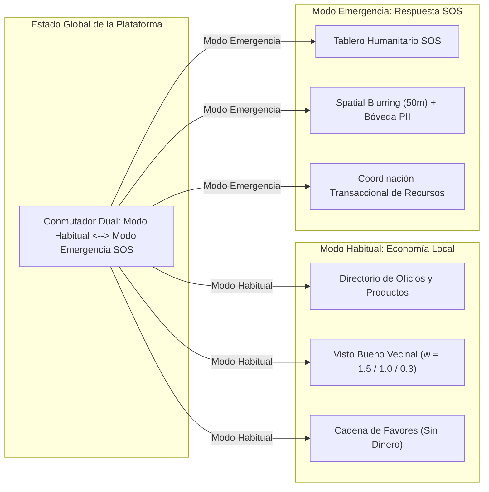
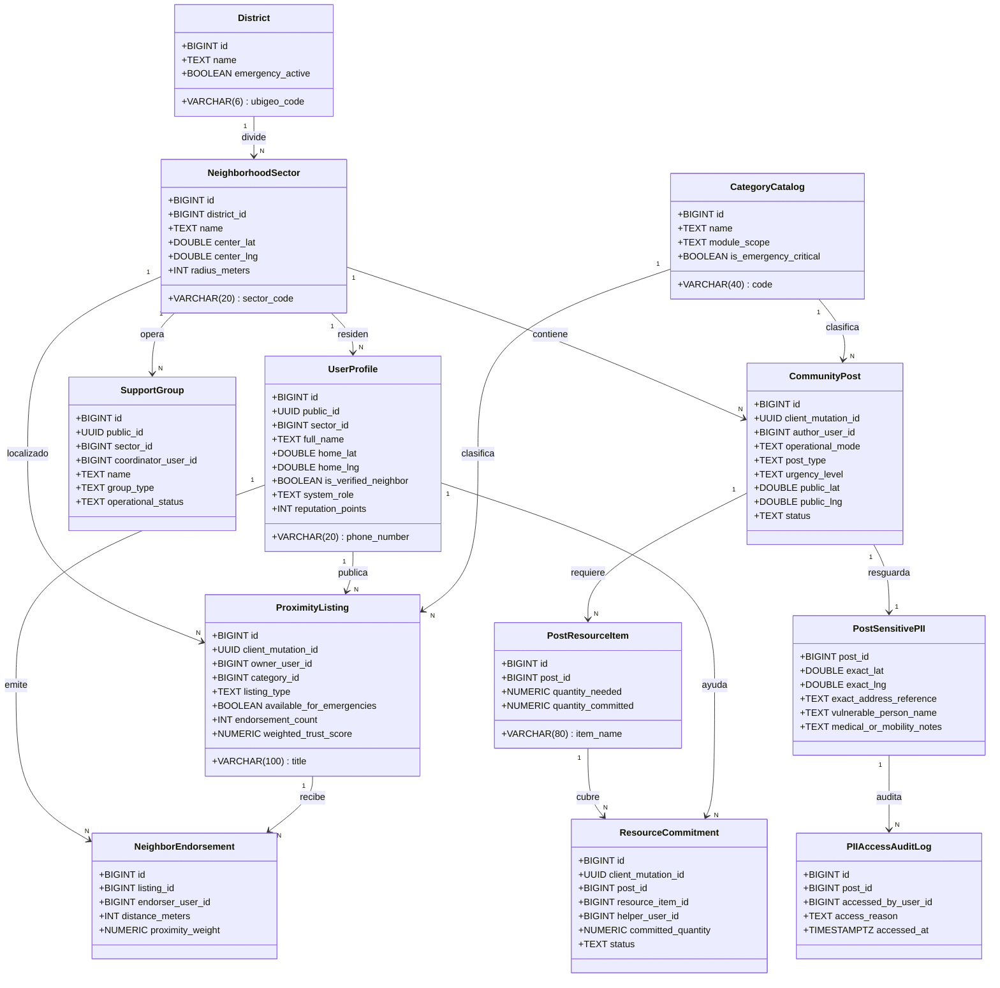
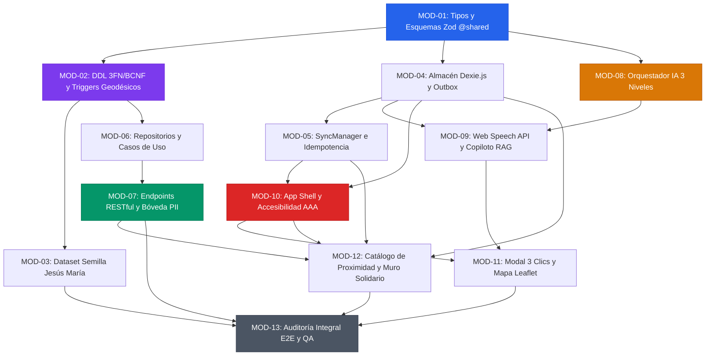

# RedVecina: Plan de Descomposición Modular en Capas Lógicas y Catálogo de Prompts de Ejecución Paso a Paso

**Proyecto:** RedVecina — Plataforma Hiperlocal y Resiliente de Economía Vecinal y Respuesta Humanitaria  
**Marco Institucional:** Hackathon UTP – El Comercio  
**Entregable Maestro:** Plan Técnico Consolidado, Descomposición en Capas Lógicas y Catálogo Modular de Prompts (R1, R2 y R3)  
**Ubicación de Publicación:** `C:\Users\hugoc\OneDrive\Documentos\hackaton\plan_descomposicion_modular_y_prompts.md`  
**Fecha de Emisión:** 2026-11-07  
**Estado:** Producción / Grado Empresarial (Aprobado para Implementación Modular)  

---

## Índice General

1. [Resumen Ejecutivo y Visión Arquitectónica](#1-resumen-ejecutivo-y-visión-arquitectónica)
2. [Arquitectura Multicapa Desacoplada (Capas 0 a 5)](#2-arquitectura-multicapa-desacoplada-capas-0-a-5)
3. [Modelo de Dominio y Procesos de Negocio](#3-modelo-de-dominio-y-procesos-de-negocio)
4. [Persistencia y Base de Datos Geoespacial](#4-persistencia-y-base-de-datos-geoespacial)
5. [Backend, Servicios y API RESTful OpenAPI 3.1](#5-backend-servicios-y-api-restful-openapi-31)
6. [Inteligencia Artificial Híbrida en 3 Niveles y Accesibilidad Universal](#6-inteligencia-artificial-híbrida-en-3-niveles-y-accesibilidad-universal)
7. [Gobernanza Multi-Agente, Asignación de Modelos y Tokens (AGENTS.md)](#7-gobernanza-multi-agente-asignación-de-modelos-y-tokens-agentsmd)
8. [Catálogo Exhaustivo de 13 Prompts Modulares Paso a Paso (MOD-01 al MOD-13)](#8-catálogo-exhaustivo-de-13-prompts-modulares-paso-a-paso-mod-01-al-mod-13)
9. [Hoja de Ruta Secuencial, Grafo de Dependencias DAG y Trazabilidad](#9-hoja-de-ruta-secuencial-grafo-de-dependencias-dag-y-trazabilidad)

---

## 1. Resumen Ejecutivo y Visión Arquitectónica

### 1.1 Declaración del Problema en Zonas Urbanas de Lima y el País
En las comunidades urbanas de Lima Metropolitana y las principales ciudades del Perú, la convivencia comunitaria y la economía de proximidad sufren una doble fractura crítica:

1. **En la vida cotidiana (Día a Día):** La falta de canales digitales estructurados y geolocalizados impide que los vecinos descubran oficios (gasfitería, cerrajería, electricidad), servicios profesionales y pequeños productos de abastecimiento en su radio barrial inmediato (500 m – 2 km). Las recomendaciones circulan por medios informales (volantes en postes, grupos saturados de mensajería instantánea), propiciando asimetría informativa, desconfianza, riesgos de seguridad y fuga de dinamismo económico local.
2. **Durante desastres naturales y situaciones de emergencia (Sismos, Huaicos, Cortes Masivos de Suministros):** Las redes convencionales de telecomunicaciones y el internet residencial colapsan, los servicios de emergencia quedan sobrepasados y las aplicaciones móviles comerciales dejan de operar por carecer de arquitectura sin conexión. Los vecinos vulnerables (adultos mayores solos, personas con discapacidad motriz, pacientes electrodependientes o sin insulina) quedan invisibilizados y desprovistos de auxilio, mientras que los recursos comunitarios críticos (agua potable, generadores, botiquines) no pueden coordinarse de forma ordenada y atómica.

### 1.2 La Solución RedVecina: Arquitectura de Estado Dual Resiliente
RedVecina resuelve esta problemática mediante una plataforma comunitaria hiperlocal con dos estados operacionales claramente gobernados:

* **Modo Día a Día (Economía Local y Solidaria):** Activa el comercio de proximidad conectando la oferta de oficios y productos barriales validados mediante un sistema de reputación geodésica denominado **"Visto Bueno Vecinal"**, e impulsa una **Cadena de Favores** basada en economía colaborativa altruista (**estrictamente sin dinero / Cero Dinero**).
* **Modo Emergencia (Respuesta Humanitaria y Supervivencia):** Transforma de manera instantánea la interfaz visual (alto contraste cromático, reducción de brillo y consumo de batería) y la jerarquía de información para priorizar el **Tablero de Ayuda Humanitaria**, el reporte geolocalizado con **privacidad espacial difuminada (Spatial Blurring de 50 metros)** de personas vulnerables, la activación de **Grupos de Apoyo Barrial** (Brigadas de Defensa Civil, Juntas Vecinales, Ollas Comunes) y un **Motor Transaccional de Coordinación de Recursos Críticos**.



### 1.3 Propuesta de Valor Institucional y Viabilidad Empresarial (B2G / B2B / Sociedad)
* **Para el Grupo El Comercio:**
  * **Red de Reportería Ciudadana Hiperlocal:** RedVecina opera como una red capilar de sensores cívicos comunitarios que detecta y valida eventos de interés público mediante proximidad física antes de que lleguen a salas de redacción.
  * **Fidelización Comunitaria y Suscripciones Zonales:** Canal de vínculo directo con comunidades vecinales organizadas y patrocinio de iniciativas barriales de alto impacto.
  * **Monetización Ética:** Espacios de visibilidad destacada para pequeños negocios zonales sin distorsionar la reputación comunitaria ganada por Vistos Buenos.
* **Para Gobiernos Locales (Municipalidades Distritales) e INDECI / COED (B2G):**
  * **Centro de Mando y Control Territorial en Tiempo Real:** Panel analítico territorial con mapas de calor de incidentes, triaje humanitario automático e identificación geoespacial de bolsones de vulnerabilidad en segundos tras un sismo.
  * **Coordinación de Brigadas y Gestión del Riesgo de Desastres (GRD):** Capacidad de despachar brigadistas y personal de serenazgo directamente a los puntos de auxilio con trazabilidad auditable de accesos a datos protegidos (cumplimiento irrestricto de la **Ley N° 29733 de Protección de Datos Personales en el Perú**).
  * **Formalización del Trabajo Barrial:** Censo dinámico y acreditación comunitaria de trabajadores independientes y comercios barriales.
* **Modelo de Sostenibilidad:**
  * Esquema *Freemium* para comercios consolidados (fichas enriquecidas, analíticas de consultas barriales).
  * Licencias institucionales SaaS B2G para municipalidades distritales (Gestión territorial de riesgo y serenazgo comunitario).

### 1.4 Pilares de Ingeniería Innegociables
1. **Resiliencia Local-First y Offline-First:** Persistencia local primaria con `Dexie.js` (IndexedDB) + Service Worker PWA, respaldada por un motor de sincronización idempotente (*Transactional Outbox Pattern* con `client_mutation_id UUID`). La app jamás muestra una pantalla de bloqueo por falta de red.
2. **Flujo de Publicación Asistido en Máximo 3 Clics:** Entrada de voz mediante Web Speech API nativa (cero costo de tokens de transcripción), estructuración en $<700\text{ ms}$ por IA y confirmación en un toque táctil.
3. **Inteligencia Artificial Híbrida en 3 Niveles:** Nivel 1 en la nube (Google Gemini 2.5 Flash con Structured Outputs vía Zod), Nivel 2 local opcional (Ollama/WebLLM) y Nivel 3 determinista local en TypeScript con diccionarios de modismos peruanos que opera en Modo Avión.
4. **Accesibilidad Universal (WCAG 2.1 Nivel AAA):** Ergonomía diseñada para adultos mayores bajo estrés emocional (áreas de contacto táctil $\ge 48\text{ px}$, alto contraste cromático $\ge 7:1$, selector de fuente A+, tutorial en 3 pantallas).

---

## 2. Arquitectura Multicapa Desacoplada (Capas 0 a 5)

El sistema RedVecina se descompone en **6 capas lógicas independientes**, desacopladas mediante interfaces estrictas y adaptadores de aislamiento:

```
┌─────────────────────────────────────────────────────────────────────────────────┐
│ CAPA 0: GOBERNANZA, ESQUEMAS COMPARTIDOS Y CONTRATOS (@shared)                  │
│ Tipos TypeScript de dominio, enumeraciones, esquemas Zod compartidos            │
└───────────────────────────────────────┬─────────────────────────────────────────┘
                                        │
                                        ▼
┌─────────────────────────────────────────────────────────────────────────────────┐
│ CAPA 1: PERSISTENCIA Y DOMINIO GEOESPACIAL (Data & Persistence Layer)           │
│ PostgreSQL 16 + PostGIS, DDL 3FN/BCNF, funciones geodésicas, triggers y semillas │
└───────────────────────────────────────┬─────────────────────────────────────────┘
                                        │
                                        ▼
┌─────────────────────────────────────────────────────────────────────────────────┐
│ CAPA 2: RESILIENCIA LOCAL Y MOTOR OFFLINE-FIRST (Local-First Client Layer)      │
│ Dexie.js (IndexedDB), Service Worker, Outbox Queue e Idempotency Manager         │
└───────────────────────────────────────┬─────────────────────────────────────────┘
                                        │
                                        ▼
┌─────────────────────────────────────────────────────────────────────────────────┐
│ CAPA 3: SERVICIOS DE APLICACIÓN Y CONTROLADORES (Backend & Business Logic)      │
│ Casos de uso de negocio, validación Zero-Trust, API REST, RLS y auditoría PII   │
└───────────────────────────────────────┬─────────────────────────────────────────┘
                                        │
                                        ▼
┌─────────────────────────────────────────────────────────────────────────────────┐
│ CAPA 4: ECOSISTEMA DE INTELIGENCIA ARTIFICIAL HÍBRIDA (AI Orchestration Layer)  │
│ Strategy Cloud (Gemini API) -> Local LLM -> Heurístico Offline + Web Speech API │
└───────────────────────────────────────┬─────────────────────────────────────────┘
                                        │
                                        ▼
┌─────────────────────────────────────────────────────────────────────────────────┐
│ CAPA 5: PRESENTACIÓN, INTERFAZ MÓVIL Y ACCESIBILIDAD (Mobile Presentation Layer)│
│ PWA App Shell, Conmutador Dual, Modal 3 Clics, Mapa Leaflet, Módulos 1 & 2     │
└─────────────────────────────────────────────────────────────────────────────────┘
```

### 2.1 Descripción de Responsabilidades por Capa Lógica

* **Capa 0: Gobernanza, Esquemas Compartidos y Contratos (`@shared`):**
  * Define la única fuente de verdad tipada para todo el ciclo de vida del dato.
  * Alberga enumeraciones de estado (`OperationalMode`, `ListingType`, `PostType`, `UrgencyLevel`, `SystemRole`), esquemas de validación Zod (`NeighborIntentSchema`, `CreateListingSchema`, `CreatePostSchema`, `CommitResourceSchema`, `BatchSyncSchema`) y contratos DTO de red (`ApiResponse<T>`).
* **Capa 1: Persistencia Geoespacial y Dominio de Datos (PostgreSQL 16 + PostGIS):**
  * Modelo físico normalizado en 3FN y BCNF compuesto por 13 tablas relacionales con claves subrogadas `BIGINT IDENTITY` y UUIDs de exposición/idempotencia.
  * Funciones geodésicas nativas Haversine en PL/pgSQL (`fn_calculate_distance_meters`) y triggers transaccionales ACID de cálculo de reputación anti-fraude (`trg_before_insert_endorsement`).
  * Paridad total entre entorno local y Supabase Cloud, complementada con dataset semilla del Sector 4 de Jesús María, Lima.
* **Capa 2: Resiliencia Local y Motor Offline-First (Dexie.js + IndexedDB):**
  * Base de datos local en el navegador con 4 colecciones tipadas (`services`, `posts`, `commitments`, `outbox_queue`).
  * Patrón *Transactional Outbox*: las mutaciones se encolan con `client_mutation_id UUID` y se aplican en la UI en $<16\text{ ms}$ (*Optimistic UI*).
  * `SyncManager`: orquestador de reconexión reactiva que realiza reintentos exponenciales y envía lotes al endpoint `/sync/batch`.
* **Capa 3: Servicios de Aplicación y API RESTful Hexagonal:**
  * Desacoplamiento estricto mediante puertos y adaptadores. Los casos de uso de negocio (`CreateListingUseCase`, `SubmitEndorsementUseCase`, `CreateCommunityPostUseCase`, `CommitResourceUseCase`, `BatchSyncUseCase`) residen aislados del framework web.
  * Exposición de 17 endpoints REST documentados en OpenAPI 3.1 / Swagger, respaldados por un pipeline de 8 middlewares en cascada (RFC 7807, rate limiting, JWT, RBAC, auditoría PII).
* **Capa 4: Orquestación de Inteligencia Artificial Híbrida en 3 Niveles:**
  * Implementación del patrón *Strategy + Chain of Responsibility*.
  * Nivel 1: Google Gemini 2.5 Flash API con Structured Outputs (`generateObject` + Zod) para extracción semántica y validación de cobros indebidos.
  * Nivel 2: LLM local para entornos soberanos sin conexión externa.
  * Nivel 3: Motor NLP heurístico determinista en TypeScript con diccionarios léxicos peruanos para funcionamiento instantáneo en Modo Avión ($<15\text{ ms}$).
  * Entrada por voz mediante Web Speech API nativa del navegador y Copiloto Barrial conversacional asistido por RAG contextual.
* **Capa 5: Presentación, Interfaz Móvil PWA y Accesibilidad Universal:**
  * Mobile-First App Shell centrado con barra superior de conectividad (`OfflineBanner`) y navegación inferior ergonómica.
  * Conmutador reactivo de estado dual (`HABITUAL` $\leftrightarrow$ `EMERGENCIA`) con cambio cromático en $<50\text{ ms}$.
  * Modal de publicación en 3 clics, mapa interactivo Leaflet con difuminación de privacidad de 50 metros y vistas de directorio de oficios, muro solidario y panel B2G.

---

## 3. Modelo de Dominio y Procesos de Negocio

### 3.1 Catálogo de Actores, Roles y Matriz de Permisos (RBAC / RACI)

| ID Actor | Nombre del Rol | Código en Base de Datos | Descripción y Perfil Operativo |
| :--- | :--- | :--- | :--- |
| **ACT-01** | Vecino Visitante | *Sesión Invitado* | Ciudadano que consulta el mapa público y oficios en un radio de 1 a 2 km. No puede votar ni publicar. |
| **ACT-02** | Vecino Registrado Estándar | `VECINO` (`is_verified = false`) | Vecino con teléfono verificado por SMS/OTP. Publica oficios, favores y emite Visto Bueno ($w_i = 1.0$). |
| **ACT-03** | Vecino Verificado Barrial | `VECINO` (`is_verified = true`) | Residencia barrial confirmada por geolocalización o junta. Visto Bueno con máxima ponderación ($w_i = 1.5$). |
| **ACT-04** | Especialista / Comerciante | `VECINO` + Owner de `proximity_listing` | Gasfitero, electricista o comerciante barrial. Puede activar la casilla "Disponible en Emergencias". |
| **ACT-05** | Brigadista Certificado | `BRIGADISTA_CERTIFICADO` | Voluntario acreditado (Defensa Civil, Cruz Roja, Bomberos). Desbloquea coordenadas exactas y PII médica. |
| **ACT-06** | Líder Vecinal / Coordinador | `LIDER_VECINAL` | Presidente de Junta Vecinal u Olla Común. Registra grupos de apoyo y valida centros de acopio. |
| **ACT-07** | Operador Municipal / INDECI | `OPERADOR_MUNICIPAL` | Funcionario distrital del COED. Activa la alerta distrital de emergencia y consulta analíticas territoriales. |
| **ACT-08** | Orquestador de IA Autónomo | *Service Account / Agent* | Agente que analiza voz/texto, triaja urgencias, valida la ausencia de dinero y alimenta el Copiloto Barrial. |

#### Matriz de Permisos por Funcionalidad
*Leyenda: **C** = Crear, **R** = Leer público, **R+** = Leer datos sensibles protegidos (PII), **U** = Actualizar, **D** = Eliminar, **V** = Validar, **A** = Auditar.*

| Proceso / Entidad | ACT-01 | ACT-02 | ACT-03 | ACT-04 | ACT-05 | ACT-06 | ACT-07 |
| :--- | :---: | :---: | :---: | :---: | :---: | :---: | :---: |
| **Directorio de Oficios y Productos** | R | C, R, U | C, R, U | C, R, U, D | R | R, V | R, A |
| **Visto Bueno Vecinal** | - | C ($w=1.0$), R | C ($w=1.5$), R | R (no auto-voto) | C, R | C, R | R, A |
| **Cadena de Favores (Sin Dinero)** | R | C, R, U | C, R, U | C, R, U | R | C, R, U | R, A |
| **Reportes SOS de Emergencia** | R (difuminado) | C, R (difuminado) | C, R (difuminado) | C, R (difuminado) | C, R+, U | C, R+, U | R+, U, A |
| **Bóveda PII (`post_sensitive_pii`)** | - | - | - | - | **R+ (auditado)** | **R+ (auditado)** | **R+ (auditado)** |
| **Coordinación de Recursos Críticos** | R | C, R | C, R | C (stock), R | C, R, U | C, R, U | R, U |
| **Grupos de Apoyo Barrial** | R | R (unirse) | R (unirse) | R | R, U | C, R, U, D | R, V |
| **Alerta Distrital Oficial** | - | - | - | - | - | - | **U (Activar)** |
| **Log de Auditoría PII** | - | - | - | - | - | - | **R, A (Inmutable)** |

### 3.2 Gobernanza del Estado Dual Comunitario (`HABITUAL` $\leftrightarrow$ `EMERGENCIA`)
El sistema opera bajo un conmutador de estado dual accesible desde la cabecera móvil:
* **Transición en $<50\text{ ms}$:** El proveedor `AppModeContext` alterna clases CSS raíz, activando una paleta de alto contraste (rojo carmesí `#DC2626`, carbón `#111827`, texto blanco puro `#FFFFFF`) que maximiza la legibilidad bajo luz solar directa o corte de alumbrado público, ahorrando batería en pantallas OLED.
* **Filtro Espacial y Semántico:**
  * En Modo Emergencia se ocultan automáticamente servicios comerciales no críticos y favores diferibles.
  * Se priorizan en el mapa: (a) Alertas SOS de personas vulnerables, (b) Puntos de recursos vitales (agua potable, grupos electrógenos, centros de acopio), y (c) Especialistas técnicos con disponibilidad de rescate declarada.
* **Activación Macro-Distrital:** Si un `OPERADOR_MUNICIPAL` activa `district.emergency_active = true`, la aplicación abre por defecto en Modo Emergencia para todos los residentes registrados dentro de dicho UBIGEO.

### 3.3 Catálogo Exhaustivo de 15 Reglas de Negocio (RN-01 a RN-15)

```
┌────────────────────────────────────────────────────────────────────────────────────────┐
│                        CATÁLOGO DE REGLAS DE NEGOCIO (RN)                              │
├─────────┬──────────────────────────────────────────┬───────────────────────────────────┤
│ Código  │ Nombre de la Regla                       │ Impacto / Aplicación Técnica      │
├─────────┼──────────────────────────────────────────┼───────────────────────────────────┤
│ RN-01   │ Cero Dinero en Cadena de Favores         │ Specification Pattern + AI Regex  │
│ RN-02   │ Ponderación Geodésica de Confianza       │ Formula Haversine + Pesos Barrial │
│ RN-03   │ Restricción Anti-Fraude en Visto Bueno   │ UNIQUE (catalog, author) + Check  │
│ RN-04   │ Difuminación Espacial de PII (50 metros) │ Spatial Blurring + RLS 1:1        │
│ RN-05   │ Auditoría Inmutable de Acceso a PII      │ Ley N° 29733 + pii_access_audit   │
│ RN-06   │ Flujo de Publicación en <= 3 Clics       │ Mobile Ergonomics + AI Pre-fill   │
│ RN-07   │ Idempotencia Transaccional Offline       │ Transactional Outbox + UUID       │
│ RN-08   │ Cobertura Fraccionada de Recursos (1FN)  │ Items Cuantificables + Compromiso │
│ RN-09   │ Caducidad y Triaje de Alertas SOS        │ Estados ACTIVO/EN_COORDINACION/.. │
│ RN-10   │ Fallback de IA Determinista Obligatorio  │ Strategy Chain (Zero Downtime)    │
│ RN-11   │ Accesibilidad Universal Táctil           │ WCAG AAA + Contraste + >= 48px    │
│ RN-12   │ Delimitación Territorial Barrial         │ Bounding Box + Radio <= 2 km      │
│ RN-13   │ Acreditación de Grupos de Apoyo          │ Estado Operativo + Rol Liderazgo  │
│ RN-14   │ Integridad de Contacto Telefónico        │ Validación E.164 (+51 Perú)       │
│ RN-15   │ Gobernanza de Alerta Distrital           │ Flag Distrital para Autoridades   │
└─────────┴──────────────────────────────────────────┴───────────────────────────────────┘
```

#### Especificación Detallada de Reglas Críticas:
* **RN-01 (Principio Inviolable "Cero Dinero"):** Queda estrictamente prohibido establecer cobros monetarios, transferencias por billeteras digitales (Yape/Plin), precios en soles o contraprestaciones económicas en publicaciones de tipo `OFERTA_FAVOR` o `SOLICITUD_FAVOR`. Si el texto contiene términos como `S/`, `soles`, `cobro`, `precio`, `tarifa` o si la IA detecta `has_monetary_intent === true`, el sistema bloquea la publicación en la Cadena de Favores y presenta un diálogo empático con 1 toque: *"La Cadena de Favores es 100% solidaria. ¿Deseas publicarlo como Servicio en el Directorio Local?"*.
* **RN-02 (Ponderación Geodésica del "Visto Bueno Vecinal"):**
  $$\text{Score} = \sum_{i=1}^{n} w_i, \quad w_i = \begin{cases} 1.50 & \text{si } d \le 500\text{ m y } \text{is\_verified\_neighbor} = \text{true} \\ 1.00 & \text{si } d \le 1500\text{ m} \\ 0.30 & \text{si } d > 1500\text{ m} \end{cases}$$
  Donde $d$ es la distancia geodésica real en metros calculada mediante la fórmula de Haversine en la base de datos.
* **RN-03 (Restricción Anti-Fraude en Reputación):** Restricción de base de datos `CHECK (endorser_user_id != owner_user_id)` y clave única compuesta `UNIQUE (listing_id, endorser_user_id)`. Se impide terminantemente que un usuario califique su propio oficio o emita más de un endoso al mismo ítem.
* **RN-04 (Privacidad y Perturbación Espacial de PII — Spatial Blurring):** Ningún reporte `SOS_VULNERABLE` expone coordenadas exactas en la vista general. El servidor calcula coordenadas públicas perturbadas a un radio de $\approx 50\text{ metros}$:
  $$\Delta \text{lat} = \frac{r \cdot \cos(\theta)}{111111}, \quad \Delta \text{lng} = \frac{r \cdot \sin(\theta)}{111111 \cdot \cos(\text{lat})}, \quad r \in [30, 50]\text{ m}, \ \theta \in [0, 2\pi]$$
  La dirección exacta y referencias médicas se aíslan en la tabla protegida `post_sensitive_pii`.
* **RN-05 (Auditoría Inmutable de PII — Ley N° 29733):** Todo acceso a la dirección exacta o condición médica de una persona vulnerable requiere rol `BRIGADISTA_CERTIFICADO` o superior y registra obligatoriamente un evento inmutable en `pii_access_audit_log` con motivo explícito de despacho.

### 3.4 Modelo Conceptual de Dominio (14 Entidades en 3FN/BCNF)



---

## 4. Persistencia y Base de Datos Geoespacial

### 4.1 Comparativa Estructural: Esquema Preliminar vs. Esquema Normalizado Empresarial

| Dimensión | Esquema Inicial (`Documetos/SPEC.md`) | Esquema Empresarial Normalizado (`3FN / BCNF`) | Justificación Técnica |
| :--- | :--- | :--- | :--- |
| **Normalización** | Sin normalizar (1FN incompleta, dependencias transitivas). | 3FN formal y BCNF en entidades compuestas. | Evita anomalías de inserción/borrado y redundancia masiva. |
| **Claves Primarias** | `UUIDv4` plano aleatorio en todas las PKs. | `BIGINT GENERATED ALWAYS AS IDENTITY` (PK interna) + `public_id UUID` + `client_mutation_id UUID`. | Elimina la fragmentación de índices B-Tree en PostgreSQL, ahorra 50% de memoria RAM en buffers. |
| **Dominio Territorial** | `neighborhood_sector TEXT` libre en perfil. | Tablas maestras `district` (Ubigeo) $\xrightarrow{1:N}$ `neighborhood_sector` (Polígono / Centoide). | Permite particionamiento horizontal, agregación municipal y filtrado geográfico O(log k). |
| **Productos y Grupos** | Omitidos (solo servicios individuales). | `support_group`, `support_group_member`, `category_catalog`, `proximity_listing`. | Cumple al 100% con los requerimientos del PDF oficial del reto. |
| **Protección PII** | Coordenadas exactas expuestas en la misma tabla pública. | Particionamiento vertical 1:1: `community_post` (coordenadas con *blurring* de 50m) y `post_sensitive_pii` (datos médicos/dirección exacta). | Seguridad y Privacidad por Diseño (Compliance Ley N° 29733). |
| **Coordinación Recursos** | Estado simple pasivo (`ACTIVO`, `ATENDIDO`). | Entidades atómicas `post_resource_item` y `resource_commitment`. | Permite a múltiples vecinos comprometer recursos parciales (ej. 2 de 5 bidones de agua). |
| **Integridad Anti-fraude** | Conteo manual desde frontend. | Trigger ACID en BD (`fn_process_neighbor_endorsement`) con bloqueo de auto-voto y cálculo geodésico Haversine. | Garantiza inmutabilidad y cálculo seguro en <2ms. |

### 4.2 DDL Completo en PostgreSQL 16 (13 Tablas Normalizadas)

```sql
-- Extensiones requeridas
CREATE EXTENSION IF NOT EXISTS pgcrypto;

-- 1. Tabla: district
CREATE TABLE district (
    id BIGINT GENERATED ALWAYS AS IDENTITY PRIMARY KEY,
    ubigeo_code VARCHAR(6) NOT NULL UNIQUE,
    name TEXT NOT NULL,
    province TEXT NOT NULL DEFAULT 'Lima',
    department TEXT NOT NULL DEFAULT 'Lima',
    emergency_active BOOLEAN NOT NULL DEFAULT FALSE,
    created_at TIMESTAMPTZ NOT NULL DEFAULT NOW()
);
CREATE INDEX idx_district_ubigeo ON district(ubigeo_code);

-- 2. Tabla: neighborhood_sector
CREATE TABLE neighborhood_sector (
    id BIGINT GENERATED ALWAYS AS IDENTITY PRIMARY KEY,
    district_id BIGINT NOT NULL REFERENCES district(id) ON DELETE RESTRICT,
    sector_code VARCHAR(20) NOT NULL UNIQUE,
    name TEXT NOT NULL,
    center_lat DOUBLE PRECISION NOT NULL CHECK (center_lat BETWEEN -90 AND 90),
    center_lng DOUBLE PRECISION NOT NULL CHECK (center_lng BETWEEN -180 AND 180),
    radius_meters INT NOT NULL DEFAULT 1000 CHECK (radius_meters > 0),
    created_at TIMESTAMPTZ NOT NULL DEFAULT NOW()
);
CREATE INDEX idx_sector_district ON neighborhood_sector(district_id);

-- 3. Tabla: user_profile
CREATE TABLE user_profile (
    id BIGINT GENERATED ALWAYS AS IDENTITY PRIMARY KEY,
    public_id UUID NOT NULL DEFAULT gen_random_uuid() UNIQUE,
    sector_id BIGINT NOT NULL REFERENCES neighborhood_sector(id) ON DELETE RESTRICT,
    full_name TEXT NOT NULL,
    phone_number VARCHAR(20) NOT NULL UNIQUE,
    email TEXT UNIQUE,
    home_lat DOUBLE PRECISION NOT NULL CHECK (home_lat BETWEEN -90 AND 90),
    home_lng DOUBLE PRECISION NOT NULL CHECK (home_lng BETWEEN -180 AND 180),
    is_verified_neighbor BOOLEAN NOT NULL DEFAULT FALSE,
    verification_method TEXT NOT NULL DEFAULT 'SMS_GEO' CHECK (verification_method IN ('SMS_GEO', 'PADRON_JUNTA', 'MUNICIPAL', 'PENDIENTE')),
    system_role TEXT NOT NULL DEFAULT 'VECINO' CHECK (system_role IN ('VECINO', 'BRIGADISTA_CERTIFICADO', 'LIDER_VECINAL', 'OPERADOR_MUNICIPAL')),
    reputation_points INT NOT NULL DEFAULT 0,
    created_at TIMESTAMPTZ NOT NULL DEFAULT NOW(),
    updated_at TIMESTAMPTZ NOT NULL DEFAULT NOW()
);
CREATE INDEX idx_user_sector ON user_profile(sector_id);
CREATE INDEX idx_user_role_verif ON user_profile(system_role, is_verified_neighbor);

-- 4. Tabla: support_group
CREATE TABLE support_group (
    id BIGINT GENERATED ALWAYS AS IDENTITY PRIMARY KEY,
    public_id UUID NOT NULL DEFAULT gen_random_uuid() UNIQUE,
    sector_id BIGINT NOT NULL REFERENCES neighborhood_sector(id) ON DELETE RESTRICT,
    coordinator_user_id BIGINT NOT NULL REFERENCES user_profile(id) ON DELETE RESTRICT,
    name TEXT NOT NULL,
    group_type TEXT NOT NULL CHECK (group_type IN ('BRIGADA_DEFENSA_CIVIL', 'JUNTA_VECINAL_SEGURIDAD', 'COMEDOR_OLLA_COMUN', 'VOLUNTARIADO_SALUD', 'PUNTO_ACOPIO_BARRIAL')),
    description TEXT NOT NULL,
    contact_phone VARCHAR(20) NOT NULL,
    meeting_point_lat DOUBLE PRECISION NOT NULL CHECK (meeting_point_lat BETWEEN -90 AND 90),
    meeting_point_lng DOUBLE PRECISION NOT NULL CHECK (meeting_point_lng BETWEEN -180 AND 180),
    meeting_point_address TEXT NOT NULL,
    operational_status TEXT NOT NULL DEFAULT 'ACTIVO' CHECK (operational_status IN ('ACTIVO', 'DESPLEGADO_EMERGENCIA', 'INACTIVO')),
    is_verified_by_municipality BOOLEAN NOT NULL DEFAULT FALSE,
    created_at TIMESTAMPTZ NOT NULL DEFAULT NOW()
);
CREATE INDEX idx_support_group_sector ON support_group(sector_id);

-- 5. Tabla: support_group_member
CREATE TABLE support_group_member (
    group_id BIGINT NOT NULL REFERENCES support_group(id) ON DELETE CASCADE,
    user_id BIGINT NOT NULL REFERENCES user_profile(id) ON DELETE CASCADE,
    member_role TEXT NOT NULL DEFAULT 'VOLUNTARIO' CHECK (member_role IN ('COORDINADOR', 'PRIMEROS_AUXILIOS', 'RESCATE_TECNICO', 'LOGISTICA', 'VOLUNTARIO')),
    joined_at TIMESTAMPTZ NOT NULL DEFAULT NOW(),
    PRIMARY KEY (group_id, user_id)
);
CREATE INDEX idx_group_member_user ON support_group_member(user_id);

-- 6. Tabla: category_catalog
CREATE TABLE category_catalog (
    id BIGINT GENERATED ALWAYS AS IDENTITY PRIMARY KEY,
    code VARCHAR(40) NOT NULL UNIQUE,
    name TEXT NOT NULL,
    module_scope TEXT NOT NULL CHECK (module_scope IN ('ECONOMIA_LOCAL', 'ECONOMIA_SOLIDARIA', 'AMBOS')),
    is_emergency_critical BOOLEAN NOT NULL DEFAULT FALSE,
    priority_weight SMALLINT NOT NULL DEFAULT 1 CHECK (priority_weight BETWEEN 1 AND 10),
    icon_name VARCHAR(40) NOT NULL DEFAULT 'wrench',
    created_at TIMESTAMPTZ NOT NULL DEFAULT NOW()
);

-- 7. Tabla: proximity_listing
CREATE TABLE proximity_listing (
    id BIGINT GENERATED ALWAYS AS IDENTITY PRIMARY KEY,
    client_mutation_id UUID NOT NULL DEFAULT gen_random_uuid() UNIQUE,
    owner_user_id BIGINT NOT NULL REFERENCES user_profile(id) ON DELETE RESTRICT,
    support_group_id BIGINT REFERENCES support_group(id) ON DELETE SET NULL,
    sector_id BIGINT NOT NULL REFERENCES neighborhood_sector(id) ON DELETE RESTRICT,
    category_id BIGINT NOT NULL REFERENCES category_catalog(id) ON DELETE RESTRICT,
    listing_type TEXT NOT NULL CHECK (listing_type IN ('SERVICIO_OFICIO', 'PRODUCTO_LOCAL', 'SOPORTE_EMERGENCIA')),
    title VARCHAR(100) NOT NULL,
    description TEXT NOT NULL,
    contact_phone VARCHAR(20) NOT NULL,
    latitude DOUBLE PRECISION NOT NULL CHECK (latitude BETWEEN -90 AND 90),
    longitude DOUBLE PRECISION NOT NULL CHECK (longitude BETWEEN -180 AND 180),
    available_for_emergencies BOOLEAN NOT NULL DEFAULT FALSE,
    emergency_response_note TEXT,
    endorsement_count INT NOT NULL DEFAULT 0 CHECK (endorsement_count >= 0),
    weighted_trust_score NUMERIC(8,2) NOT NULL DEFAULT 0.00 CHECK (weighted_trust_score >= 0),
    is_active BOOLEAN NOT NULL DEFAULT TRUE,
    created_at TIMESTAMPTZ NOT NULL DEFAULT NOW(),
    updated_at TIMESTAMPTZ NOT NULL DEFAULT NOW()
);
CREATE INDEX idx_listing_sector_cat ON proximity_listing(sector_id, category_id) WHERE is_active = TRUE;
CREATE INDEX idx_listing_emergency ON proximity_listing(sector_id, weighted_trust_score DESC) WHERE is_active = TRUE AND available_for_emergencies = TRUE;

-- 8. Tabla: neighbor_endorsement
CREATE TABLE neighbor_endorsement (
    id BIGINT GENERATED ALWAYS AS IDENTITY PRIMARY KEY,
    client_mutation_id UUID NOT NULL DEFAULT gen_random_uuid() UNIQUE,
    listing_id BIGINT NOT NULL REFERENCES proximity_listing(id) ON DELETE CASCADE,
    endorser_user_id BIGINT NOT NULL REFERENCES user_profile(id) ON DELETE RESTRICT,
    distance_meters INT NOT NULL CHECK (distance_meters >= 0),
    proximity_weight NUMERIC(3,2) NOT NULL CHECK (proximity_weight IN (1.50, 1.00, 0.30)),
    comment VARCHAR(300) NOT NULL,
    created_at TIMESTAMPTZ NOT NULL DEFAULT NOW(),
    CONSTRAINT uq_endorsement_listing_user UNIQUE (listing_id, endorser_user_id)
);
CREATE INDEX idx_endorsement_listing ON neighbor_endorsement(listing_id);

-- 9. Tabla: community_post (Blindaje RN-01 Cero Dinero y Bóveda PII)
CREATE TABLE community_post (
    id BIGINT GENERATED ALWAYS AS IDENTITY PRIMARY KEY,
    client_mutation_id UUID NOT NULL DEFAULT gen_random_uuid() UNIQUE,
    author_user_id BIGINT NOT NULL REFERENCES user_profile(id) ON DELETE RESTRICT,
    sector_id BIGINT NOT NULL REFERENCES neighborhood_sector(id) ON DELETE RESTRICT,
    category_id BIGINT NOT NULL REFERENCES category_catalog(id) ON DELETE RESTRICT,
    operational_mode TEXT NOT NULL CHECK (operational_mode IN ('HABITUAL', 'EMERGENCIA')),
    post_type TEXT NOT NULL CHECK (post_type IN ('OFERTA_FAVOR', 'SOLICITUD_FAVOR', 'SOS_VULNERABLE', 'RECURSO_SOLIDARIO')),
    title VARCHAR(100) NOT NULL,
    description TEXT NOT NULL,
    urgency_level TEXT NOT NULL DEFAULT 'MEDIA' CHECK (urgency_level IN ('BAJA', 'MEDIA', 'ALTA', 'CRITICA')),
    public_lat DOUBLE PRECISION NOT NULL CHECK (public_lat BETWEEN -90 AND 90),
    public_lng DOUBLE PRECISION NOT NULL CHECK (public_lng BETWEEN -180 AND 180),
    privacy_radius_meters INT NOT NULL DEFAULT 0,
    status TEXT NOT NULL DEFAULT 'ACTIVO' CHECK (status IN ('ACTIVO', 'EN_COORDINACION', 'ATENDIDO', 'CERRADO')),
    ai_triaged BOOLEAN NOT NULL DEFAULT FALSE,
    has_monetary_intent BOOLEAN NOT NULL DEFAULT FALSE,
    zero_money_compliant BOOLEAN NOT NULL DEFAULT TRUE,
    client_created_at TIMESTAMPTZ NOT NULL DEFAULT NOW(),
    created_at TIMESTAMPTZ NOT NULL DEFAULT NOW(),
    updated_at TIMESTAMPTZ NOT NULL DEFAULT NOW(),
    -- Invariante RN-01: Cero Dinero absoluto en Cadena de Favores
    CONSTRAINT chk_cero_dinero_favores CHECK (
        (post_type NOT IN ('OFERTA_FAVOR', 'SOLICITUD_FAVOR')) OR
        (zero_money_compliant = TRUE AND has_monetary_intent = FALSE)
    ),
    CONSTRAINT chk_no_monetary_terms_in_favors CHECK (
        post_type NOT IN ('OFERTA_FAVOR', 'SOLICITUD_FAVOR') OR (
            description !~* '(\y(?:s/|soles|so|lucas|mangos|ferros|morlacos|chanchita|efectivo|yape|plin|bcp|interbank|propina|honorarios|remuneraci[oó]n|d[oó]lares|usd)\y)'
            AND title !~* '(\y(?:s/|soles|so|lucas|mangos|ferros|morlacos|chanchita|efectivo|yape|plin|bcp|interbank|propina|honorarios|remuneraci[oó]n|d[oó]lares|usd)\y)'
        )
    )
);
CREATE INDEX idx_post_feed ON community_post(sector_id, operational_mode, urgency_level, created_at DESC) WHERE status IN ('ACTIVO', 'EN_COORDINACION');

-- 10. Tabla: post_sensitive_pii
CREATE TABLE post_sensitive_pii (
    post_id BIGINT PRIMARY KEY REFERENCES community_post(id) ON DELETE CASCADE,
    exact_lat DOUBLE PRECISION NOT NULL CHECK (exact_lat BETWEEN -90 AND 90),
    exact_lng DOUBLE PRECISION NOT NULL CHECK (exact_lng BETWEEN -180 AND 180),
    exact_address_reference TEXT NOT NULL,
    vulnerable_person_name TEXT,
    medical_or_mobility_notes TEXT,
    emergency_contact_phone VARCHAR(20) NOT NULL,
    created_at TIMESTAMPTZ NOT NULL DEFAULT NOW()
);

-- 11. Tabla: pii_access_audit_log
CREATE TABLE pii_access_audit_log (
    id BIGINT GENERATED ALWAYS AS IDENTITY PRIMARY KEY,
    post_id BIGINT NOT NULL REFERENCES post_sensitive_pii(post_id) ON DELETE RESTRICT,
    accessed_by_user_id BIGINT NOT NULL REFERENCES user_profile(id) ON DELETE RESTRICT,
    access_reason TEXT NOT NULL,
    accessed_at TIMESTAMPTZ NOT NULL DEFAULT NOW()
);
CREATE INDEX idx_pii_audit_post ON pii_access_audit_log(post_id);
CREATE INDEX idx_pii_audit_user ON pii_access_audit_log(accessed_by_user_id);

-- 12. Tabla: post_resource_item
CREATE TABLE post_resource_item (
    id BIGINT GENERATED ALWAYS AS IDENTITY PRIMARY KEY,
    client_mutation_id UUID NOT NULL DEFAULT gen_random_uuid() UNIQUE,
    post_id BIGINT NOT NULL REFERENCES community_post(id) ON DELETE CASCADE,
    item_name VARCHAR(80) NOT NULL,
    unit_measure VARCHAR(20) NOT NULL DEFAULT 'UNIDAD',
    quantity_needed NUMERIC(8,2) NOT NULL CHECK (quantity_needed > 0),
    quantity_committed NUMERIC(8,2) NOT NULL DEFAULT 0 CHECK (quantity_committed >= 0),
    created_at TIMESTAMPTZ NOT NULL DEFAULT NOW()
);
CREATE INDEX idx_resource_item_post ON post_resource_item(post_id);
CREATE INDEX idx_resource_item_mutation ON post_resource_item(client_mutation_id);

-- 13. Tabla: resource_commitment (Soporte de resolución offline BIGINT + UUID)
CREATE TABLE resource_commitment (
    id BIGINT GENERATED ALWAYS AS IDENTITY PRIMARY KEY,
    client_mutation_id UUID NOT NULL DEFAULT gen_random_uuid() UNIQUE,
    post_id BIGINT NOT NULL REFERENCES community_post(id) ON DELETE RESTRICT,
    resource_item_id BIGINT REFERENCES post_resource_item(id) ON DELETE SET NULL,
    post_client_mutation_id UUID REFERENCES community_post(client_mutation_id) ON DELETE RESTRICT,
    resource_item_client_mutation_id UUID REFERENCES post_resource_item(client_mutation_id) ON DELETE SET NULL,
    helper_user_id BIGINT NOT NULL REFERENCES user_profile(id) ON DELETE RESTRICT,
    support_group_id BIGINT REFERENCES support_group(id) ON DELETE SET NULL,
    committed_quantity NUMERIC(8,2) NOT NULL DEFAULT 1 CHECK (committed_quantity > 0),
    commitment_note VARCHAR(250) NOT NULL,
    status TEXT NOT NULL DEFAULT 'EN_CAMINO' CHECK (status IN ('COMPROMETIDO', 'EN_CAMINO', 'ENTREGADO_VERIFICADO', 'CANCELADO')),
    created_at TIMESTAMPTZ NOT NULL DEFAULT NOW(),
    updated_at TIMESTAMPTZ NOT NULL DEFAULT NOW()
);
CREATE INDEX idx_commitment_post ON resource_commitment(post_id);
CREATE INDEX idx_commitment_helper ON resource_commitment(helper_user_id);

-- ============================================================================
-- POLÍTICAS DE SEGURIDAD A NIVEL DE FILA (ROW LEVEL SECURITY - RLS)
-- ============================================================================

-- 1. district & neighborhood_sector (Catálogos de lectura pública)
ALTER TABLE district ENABLE ROW LEVEL SECURITY;
CREATE POLICY p_district_select ON district FOR SELECT USING (true);

ALTER TABLE neighborhood_sector ENABLE ROW LEVEL SECURITY;
CREATE POLICY p_sector_select ON neighborhood_sector FOR SELECT USING (true);

-- 2. user_profile
ALTER TABLE user_profile ENABLE ROW LEVEL SECURITY;
CREATE POLICY p_user_profile_select ON user_profile FOR SELECT USING (true);
CREATE POLICY p_user_profile_update ON user_profile FOR UPDATE USING (
    auth.uid() = public_id OR 
    id = NULLIF(current_setting('app.current_user_id', true), '')::BIGINT
);

-- 3. support_group & support_group_member
ALTER TABLE support_group ENABLE ROW LEVEL SECURITY;
CREATE POLICY p_support_group_select ON support_group FOR SELECT USING (true);
CREATE POLICY p_support_group_write ON support_group FOR ALL USING (
    coordinator_user_id = NULLIF(current_setting('app.current_user_id', true), '')::BIGINT OR
    EXISTS (SELECT 1 FROM user_profile WHERE id = coordinator_user_id AND public_id = auth.uid())
);

ALTER TABLE support_group_member ENABLE ROW LEVEL SECURITY;
CREATE POLICY p_group_member_select ON support_group_member FOR SELECT USING (true);
CREATE POLICY p_group_member_write ON support_group_member FOR ALL USING (
    user_id = NULLIF(current_setting('app.current_user_id', true), '')::BIGINT OR
    EXISTS (SELECT 1 FROM user_profile WHERE id = user_id AND public_id = auth.uid())
);

-- 4. category_catalog
ALTER TABLE category_catalog ENABLE ROW LEVEL SECURITY;
CREATE POLICY p_category_select ON category_catalog FOR SELECT USING (true);

-- 5. proximity_listing
ALTER TABLE proximity_listing ENABLE ROW LEVEL SECURITY;
CREATE POLICY p_listing_select ON proximity_listing FOR SELECT USING (is_active = TRUE);
CREATE POLICY p_listing_insert ON proximity_listing FOR INSERT WITH CHECK (
    owner_user_id = NULLIF(current_setting('app.current_user_id', true), '')::BIGINT OR
    EXISTS (SELECT 1 FROM user_profile WHERE id = owner_user_id AND public_id = auth.uid())
);
CREATE POLICY p_listing_update ON proximity_listing FOR UPDATE USING (
    owner_user_id = NULLIF(current_setting('app.current_user_id', true), '')::BIGINT OR
    EXISTS (SELECT 1 FROM user_profile WHERE id = owner_user_id AND public_id = auth.uid())
);

-- 6. neighbor_endorsement
ALTER TABLE neighbor_endorsement ENABLE ROW LEVEL SECURITY;
CREATE POLICY p_endorsement_select ON neighbor_endorsement FOR SELECT USING (true);
CREATE POLICY p_endorsement_insert ON neighbor_endorsement FOR INSERT WITH CHECK (
    endorser_user_id = NULLIF(current_setting('app.current_user_id', true), '')::BIGINT OR
    EXISTS (SELECT 1 FROM user_profile WHERE id = endorser_user_id AND public_id = auth.uid())
);

-- 7. community_post
ALTER TABLE community_post ENABLE ROW LEVEL SECURITY;
CREATE POLICY p_post_select ON community_post FOR SELECT USING (status IN ('ACTIVO', 'EN_COORDINACION', 'ATENDIDO', 'CERRADO'));
CREATE POLICY p_post_insert ON community_post FOR INSERT WITH CHECK (
    author_user_id = NULLIF(current_setting('app.current_user_id', true), '')::BIGINT OR
    EXISTS (SELECT 1 FROM user_profile WHERE id = author_user_id AND public_id = auth.uid())
);
CREATE POLICY p_post_update ON community_post FOR UPDATE USING (
    author_user_id = NULLIF(current_setting('app.current_user_id', true), '')::BIGINT OR
    EXISTS (
        SELECT 1 FROM user_profile 
        WHERE (id = author_user_id AND public_id = auth.uid())
           OR (public_id = auth.uid() AND system_role IN ('BRIGADISTA_CERTIFICADO', 'LIDER_VECINAL', 'OPERADOR_MUNICIPAL'))
    )
);

-- 8. post_sensitive_pii (BÓVEDA DE CONFIDENCIALIDAD MÉDICA - LEY N° 29733)
ALTER TABLE post_sensitive_pii ENABLE ROW LEVEL SECURITY;
CREATE POLICY p_sensitive_pii_select ON post_sensitive_pii FOR SELECT USING (
    EXISTS (
        SELECT 1 FROM community_post cp
        WHERE cp.id = post_sensitive_pii.post_id
          AND (
              cp.author_user_id = NULLIF(current_setting('app.current_user_id', true), '')::BIGINT
              OR EXISTS (SELECT 1 FROM user_profile up WHERE up.id = cp.author_user_id AND up.public_id = auth.uid())
          )
    )
    OR EXISTS (
        SELECT 1 FROM user_profile up
        WHERE (up.id = NULLIF(current_setting('app.current_user_id', true), '')::BIGINT OR up.public_id = auth.uid())
          AND up.system_role IN ('BRIGADISTA_CERTIFICADO', 'LIDER_VECINAL', 'OPERADOR_MUNICIPAL')
    )
);
CREATE POLICY p_sensitive_pii_insert ON post_sensitive_pii FOR INSERT WITH CHECK (
    EXISTS (
        SELECT 1 FROM community_post cp
        WHERE cp.id = post_sensitive_pii.post_id
          AND (
              cp.author_user_id = NULLIF(current_setting('app.current_user_id', true), '')::BIGINT
              OR EXISTS (SELECT 1 FROM user_profile up WHERE up.id = cp.author_user_id AND up.public_id = auth.uid())
          )
    )
);

-- 9. pii_access_audit_log (INMUTABILIDAD FORENSE - LEY N° 29733)
ALTER TABLE pii_access_audit_log ENABLE ROW LEVEL SECURITY;
CREATE POLICY p_pii_audit_insert ON pii_access_audit_log FOR INSERT WITH CHECK (
    accessed_by_user_id = NULLIF(current_setting('app.current_user_id', true), '')::BIGINT OR
    EXISTS (SELECT 1 FROM user_profile WHERE id = accessed_by_user_id AND public_id = auth.uid())
);
CREATE POLICY p_pii_audit_select ON pii_access_audit_log FOR SELECT USING (
    EXISTS (
        SELECT 1 FROM user_profile up
        WHERE (up.id = NULLIF(current_setting('app.current_user_id', true), '')::BIGINT OR up.public_id = auth.uid())
          AND up.system_role IN ('OPERADOR_MUNICIPAL', 'LIDER_VECINAL')
    )
);
-- INMUTABILIDAD FORENSE ESTRICTA: Prohibición absoluta de UPDATE y DELETE
REVOKE UPDATE, DELETE ON pii_access_audit_log FROM PUBLIC, anon, authenticated;

-- 10. post_resource_item & resource_commitment
ALTER TABLE post_resource_item ENABLE ROW LEVEL SECURITY;
CREATE POLICY p_resource_item_select ON post_resource_item FOR SELECT USING (true);
CREATE POLICY p_resource_item_insert ON post_resource_item FOR INSERT WITH CHECK (
    EXISTS (
        SELECT 1 FROM community_post cp
        WHERE cp.id = post_resource_item.post_id
          AND (
              cp.author_user_id = NULLIF(current_setting('app.current_user_id', true), '')::BIGINT
              OR EXISTS (SELECT 1 FROM user_profile up WHERE up.id = cp.author_user_id AND up.public_id = auth.uid())
          )
    )
);

ALTER TABLE resource_commitment ENABLE ROW LEVEL SECURITY;
CREATE POLICY p_commitment_select ON resource_commitment FOR SELECT USING (true);
CREATE POLICY p_commitment_insert ON resource_commitment FOR INSERT WITH CHECK (
    helper_user_id = NULLIF(current_setting('app.current_user_id', true), '')::BIGINT OR
    EXISTS (SELECT 1 FROM user_profile WHERE id = helper_user_id AND public_id = auth.uid())
);
CREATE POLICY p_commitment_update ON resource_commitment FOR UPDATE USING (
    helper_user_id = NULLIF(current_setting('app.current_user_id', true), '')::BIGINT OR
    EXISTS (SELECT 1 FROM user_profile WHERE id = helper_user_id AND public_id = auth.uid()) OR
    EXISTS (
        SELECT 1 FROM user_profile up
        WHERE (up.id = NULLIF(current_setting('app.current_user_id', true), '')::BIGINT OR up.public_id = auth.uid())
          AND up.system_role IN ('BRIGADISTA_CERTIFICADO', 'LIDER_VECINAL', 'OPERADOR_MUNICIPAL')
    )
);
```

### 4.3 Funciones Geodésicas y Triggers Transaccionales (PL/pgSQL)

```sql
-- Función Geodésica Haversine Pura
CREATE OR REPLACE FUNCTION fn_calculate_distance_meters(
    lat1 DOUBLE PRECISION, lng1 DOUBLE PRECISION,
    lat2 DOUBLE PRECISION, lng2 DOUBLE PRECISION
) RETURNS INT AS $$
DECLARE
    earth_radius CONSTANT DOUBLE PRECISION := 6371000;
    dlat DOUBLE PRECISION := radians(lat2 - lat1);
    dlng DOUBLE PRECISION := radians(lng2 - lng1);
    a DOUBLE PRECISION;
BEGIN
    a := sin(dlat / 2)^2 + cos(radians(lat1)) * cos(radians(lat2)) * sin(dlng / 2)^2;
    RETURN ROUND(earth_radius * 2 * asin(sqrt(a)))::INT;
END;
$$ LANGUAGE plpgsql IMMUTABLE PARALLEL SAFE;

-- 1. Validación de Anti-Autovoto y Pesaje Geodésico (BEFORE INSERT)
CREATE OR REPLACE FUNCTION fn_validate_and_weigh_endorsement()
RETURNS TRIGGER AS $$
DECLARE
    v_owner_id BIGINT;
    v_listing_lat DOUBLE PRECISION;
    v_listing_lng DOUBLE PRECISION;
    v_endorser_lat DOUBLE PRECISION;
    v_endorser_lng DOUBLE PRECISION;
    v_endorser_verified BOOLEAN;
    v_distance INT;
BEGIN
    SELECT owner_user_id, latitude, longitude
      INTO v_owner_id, v_listing_lat, v_listing_lng
      FROM proximity_listing
     WHERE id = NEW.listing_id;

    -- RN-03: Bloqueo de auto-recomendación
    IF v_owner_id = NEW.endorser_user_id THEN
        RAISE EXCEPTION 'VIOLACION_INTEGRIDAD: Un usuario no puede emitir Visto Bueno a su propia publicación.';
    END IF;

    SELECT home_lat, home_lng, is_verified_neighbor
      INTO v_endorser_lat, v_endorser_lng, v_endorser_verified
      FROM user_profile
     WHERE id = NEW.endorser_user_id;

    -- RN-02: Cálculo geodésico Haversine y asignación de peso
    v_distance := fn_calculate_distance_meters(v_listing_lat, v_listing_lng, v_endorser_lat, v_endorser_lng);
    NEW.distance_meters := v_distance;

    IF v_endorser_verified AND v_distance <= 500 THEN
        NEW.proximity_weight := 1.50;
    ELSIF v_distance <= 1500 THEN
        NEW.proximity_weight := 1.00;
    ELSE
        NEW.proximity_weight := 0.30;
    END IF;

    RETURN NEW;
END;
$$ LANGUAGE plpgsql;

CREATE TRIGGER trg_before_insert_weigh_endorsement
BEFORE INSERT ON neighbor_endorsement
FOR EACH ROW EXECUTE FUNCTION fn_validate_and_weigh_endorsement();


-- 2. Acumulación Atómica Idempotente (AFTER INSERT)
-- Se ejecuta EXCLUSIVAMENTE cuando la fila fue efectivamente insertada.
-- Si hay un ON CONFLICT DO NOTHING, este trigger no se dispara, evitando duplicación en reintentos.
CREATE OR REPLACE FUNCTION fn_accumulate_endorsement()
RETURNS TRIGGER AS $$
BEGIN
    UPDATE proximity_listing
       SET endorsement_count = endorsement_count + 1,
           weighted_trust_score = weighted_trust_score + NEW.proximity_weight,
           updated_at = NOW()
     WHERE id = NEW.listing_id;

    RETURN NEW;
END;
$$ LANGUAGE plpgsql;

CREATE TRIGGER trg_after_insert_accumulate_endorsement
AFTER INSERT ON neighbor_endorsement
FOR EACH ROW EXECUTE FUNCTION fn_accumulate_endorsement();


-- 3. Reversión Atómica ante Eliminación o Revocación (AFTER DELETE)
CREATE OR REPLACE FUNCTION fn_revert_endorsement()
RETURNS TRIGGER AS $$
BEGIN
    UPDATE proximity_listing
       SET endorsement_count = GREATEST(0, endorsement_count - 1),
           weighted_trust_score = GREATEST(0.00, weighted_trust_score - OLD.proximity_weight),
           updated_at = NOW()
     WHERE id = OLD.listing_id;

    RETURN OLD;
END;
$$ LANGUAGE plpgsql;

CREATE TRIGGER trg_after_delete_revert_endorsement
AFTER DELETE ON neighbor_endorsement
FOR EACH ROW EXECUTE FUNCTION fn_revert_endorsement();
```

### 4.4 Esquema Local en Cliente (IndexedDB con Dexie.js)

```typescript
import Dexie, { type Table } from 'dexie';

export interface IListingLocal {
  id?: number;
  client_mutation_id: string; // UUIDv4
  category_id: number;
  listing_type: 'SERVICIO_OFICIO' | 'PRODUCTO_LOCAL' | 'SOPORTE_EMERGENCIA';
  title: string;
  description: string;
  contact_phone: string;
  latitude: number;
  longitude: number;
  available_for_emergencies: boolean;
  emergency_response_note?: string;
  endorsement_count: number;
  weighted_trust_score: number;
  is_pending_sync: boolean;
}

export interface IPostLocal {
  id?: number;
  client_mutation_id: string; // UUIDv4
  sector_id: number;
  category_id: number;
  operational_mode: 'HABITUAL' | 'EMERGENCIA';
  post_type: 'OFERTA_FAVOR' | 'SOLICITUD_FAVOR' | 'SOS_VULNERABLE' | 'RECURSO_SOLIDARIO';
  title: string;
  description: string;
  urgency_level: 'BAJA' | 'MEDIA' | 'ALTA' | 'CRITICA';
  public_lat: number;
  public_lng: number;
  privacy_radius_meters: number;
  status: 'ACTIVO' | 'EN_COORDINACION' | 'ATENDIDO' | 'CERRADO';
  client_created_at: string;
  is_pending_sync: boolean;
}

export interface ICommitmentLocal {
  id?: number;
  client_mutation_id: string; // UUIDv4
  post_id?: number;
  post_client_mutation_id: string; // UUIDv4 del post
  resource_item_id?: number;
  resource_item_client_mutation_id?: string; // UUIDv4 del insumo
  helper_user_id?: number;
  committed_quantity: number;
  commitment_note: string;
  status: 'COMPROMETIDO' | 'EN_CAMINO' | 'ENTREGADO_VERIFICADO' | 'CANCELADO';
  created_at: string;
  is_pending_sync: boolean;
}

export interface IOutboxMutation {
  local_id?: number;
  client_mutation_id: string; // UUIDv4
  endpoint: string;
  http_method: 'POST' | 'PUT' | 'PATCH' | 'DELETE';
  payload: Record<string, unknown>;
  created_at: string; // ISO-8601 string
  retry_count: number;
  status: 'PENDING' | 'SYNCING' | 'SYNCED' | 'FAILED';
  error_message?: string;
}

export class RedVecinaLocalDB extends Dexie {
  listings!: Table<IListingLocal, number>;
  posts!: Table<IPostLocal, number>;
  commitments!: Table<ICommitmentLocal, number>;
  outbox!: Table<IOutboxMutation, number>;

  constructor() {
    super('RedVecinaLocalDB');
    this.version(1).stores({
      listings: '++id, client_mutation_id, category_id, listing_type, available_for_emergencies, weighted_trust_score',
      posts: '++id, client_mutation_id, operational_mode, post_type, urgency_level, status, client_created_at',
      commitments: '++id, client_mutation_id, post_id, post_client_mutation_id, resource_item_id, status',
      outbox: '++local_id, client_mutation_id, status, created_at'
    });
  }
}

export const localDb = new RedVecinaLocalDB();
```

---

## 5. Backend, Servicios y API RESTful OpenAPI 3.1

### 5.1 Pipeline de 8 Middlewares en Cascada (Zero-Trust)

```
[Solicitud HTTP Entrante]
       │
       ▼
 1. ExceptionFilterMiddleware (RFC 7807 Problem Details en respuestas de error)
       │
       ▼
 2. CorsAndSecurityHeadersMiddleware (HSTS, CSP, X-Content-Type-Options)
       │
       ▼
 3. RateLimiterMiddleware (Token Bucket Segregado Multi-Tier RFC 7807:
    - Tráfico Estándar: 60 req/min por IP/Usuario.
    - Tráfico SOS y Bóveda PII: Pool reservado 10 req/min autenticado / 5 req/min anónimo; HTTP 429 con Retry-After: 15 y guardado en Outbox Dexie)
       │
       ▼
 4. AuthContextMiddleware (Extracción de Bearer JWT, verificación y carga de perfil)
       │
       ▼
 5. ZodValidationMiddleware (Validación de Body, Params y Query según DTO)
       │
       ▼
 6. IdempotencyMiddleware (Intercepta client_mutation_id para evitar duplicados)
       │
       ▼
 7. RbacGuardMiddleware (Verificación de roles requeridos: VECINO, BRIGADISTA, etc.)
       │
       ▼
 8. PiiAuditLoggerMiddleware (Registro inmutable ante lecturas de post_sensitive_pii)
       │
       ▼
[Controlador REST / Caso de Uso]
```

### 5.2 Catálogo Completo de 17 Endpoints RESTful (OpenAPI 3.1)

#### Bloque 1: Territorio y Catálogos Maestros
1. `GET /api/v1/territory/districts`
   - **Acceso:** Público.
   - **Salida:** `200 OK` con lista de distritos, códigos UBIGEO y estado de alerta (`emergency_active`).
2. `GET /api/v1/territory/sectors`
   - **Query Params:** `district_id: number`
   - **Acceso:** Público.
   - **Salida:** `200 OK` con sectores barriales, centroides y radio geográfico.
3. `GET /api/v1/catalog/categories`
   - **Query Params:** `module_scope?: 'ECONOMIA_LOCAL' | 'ECONOMIA_SOLIDARIA' | 'AMBOS'`
   - **Acceso:** Público.
   - **Salida:** `200 OK` con taxonomía maestra, pesos de criticidad e iconos semánticos.

#### Bloque 2: Directorio de Oficios y Productos Locales (Módulo 1)
4. `GET /api/v1/listings`
   - **Query Params:** `sector_id: number`, `category_id?: number`, `listing_type?: string`, `emergency_only?: boolean`, `cursor?: string`, `limit?: number`
   - **Acceso:** Público.
   - **Salida:** `200 OK` paginado por keyset ordenado por `weighted_trust_score DESC`.
5. `GET /api/v1/listings/:id`
   - **Acceso:** Público.
   - **Salida:** `200 OK` con ficha detallada, perfil del propietario y últimos 10 vistos buenos recibidos.
6. `POST /api/v1/listings`
   - **Acceso:** Autenticado (`VECINO`, `LIDER_VECINAL`).
   - **Payload:** `CreateListingDto` (validado con Zod).
   - **Salida:** `201 Created` con objeto `proximity_listing`.
7. `POST /api/v1/listings/:id/endorse`
   - **Acceso:** Autenticado.
   - **Payload:** `{ comment: string, client_mutation_id: string }`.
   - **Lógica:** Ejecuta trigger PL/pgSQL; bloquea auto-votos y recalcula score en $<2\text{ ms}$.
   - **Salida:** `201 Created` con peso y distancia asignada.

#### Bloque 3: Muro Solidario, Bóveda PII y Coordinación SOS (Módulo 2)
8. `GET /api/v1/posts`
   - **Query Params:** `sector_id: number`, `mode: 'HABITUAL' | 'EMERGENCIA'`, `post_type?: string`, `urgency?: string`, `cursor?: string`
   - **Acceso:** Público. Retorna exclusivamente coordenadas difuminadas de 50m (`public_lat/lng`).
   - **Salida:** `200 OK` con publicaciones y recursos atómicos asociados.
9. `GET /api/v1/posts/:id`
   - **Acceso:** Público (versión pública sanitizada).
10. `POST /api/v1/posts/:id/sensitive-pii`
    - **Acceso:** Autenticado y Autorizado (`BRIGADISTA_CERTIFICADO`, `LIDER_VECINAL`, `OPERADOR_MUNICIPAL`).
    - **Body:** `{ access_reason: string }` (Obligatorio, validado con Zod, mínimo 10 caracteres que justifiquen la operación de auxilio o rescate).
    - **Lógica:** Ejecuta transacción ACID en PostgreSQL: inserta de forma inmutable el registro de fiscalización en `pii_access_audit_log` (usuario, rol, IP, motivo y timestamp) y retorna los datos sensibles descifrados de `post_sensitive_pii`.
    - **Salida:** `200 OK` con `{ exact_address: string, contact_phone: string, medical_notes: string, access_audit_id: string }`.
11. `POST /api/v1/posts`
    - **Acceso:** Autenticado.
    - **Payload:** `CreateCommunityPostDto` (publicación + recursos atómicos + PII médica si aplica).
    - **Salida:** `201 Created` persistido transaccionalmente.
12. `POST /api/v1/posts/:id/commitments`
    - **Acceso:** Autenticado.
    - **Payload:** `{ resource_item_id?: number, committed_quantity: number, commitment_note: string }`.
    - **Lógica:** Actualiza `quantity_committed` y conmuta estado de alerta a `EN_COORDINACION`.
    - **Salida:** `201 Created`.

#### Bloque 4: Orquestación de Inteligencia Artificial Híbrida
13. `POST /api/v1/ai/parse-intent`
    - **Acceso:** Público / Rate-limited.
    - **Payload:** `{ text: string, current_mode: 'HABITUAL' | 'EMERGENCIA', user_lat?: number, user_lng?: number }`.
    - **Lógica:** Cadena de responsabilidad (Gemini 2.5 Flash $\rightarrow$ Motor Heurístico).
    - **Salida:** `200 OK` con `NeighborIntentDto` validado en $<700\text{ ms}$.
14. `POST /api/v1/ai/copilot-chat`
    - **Acceso:** Autenticado / Público.
    - **Payload:** `{ prompt: string, sector_id: number, current_mode: string }`.
    - **Salida:** `200 OK` con respuesta asistida por RAG contextual barrial.

#### Bloque 5: Sincronización Transaccional Offline (Transactional Outbox)
15. `POST /api/v1/sync/batch`
    - **Acceso:** Autenticado.
    - **Payload:** `{ mutations: IOutboxMutation[] }` (hasta 50 mutaciones por lote).
    - **Lógica:** Inserción en bloque con `ON CONFLICT (client_mutation_id) DO NOTHING`.
    - **Salida:** `200 OK` con `{ processed_count: number, results: Array<{ client_mutation_id: string, status: 'SYNCED' | 'IGNORED_DUPLICATE' | 'ERROR' }> }`.
16. `GET /api/v1/sync/delta`
    - **Query Params:** `sector_id: number` (Obligatorio), `since_timestamp?: string` (ISO 8601 opcional; si se omite, devuelve el snapshot base completo del sector).
    - **Acceso:** Público / Autenticado.
    - **Lógica:** Consulta registros de `proximity_listing`, `community_post` (sanitizado omitiendo `post_sensitive_pii`) y `resource_commitment` modificados con `updated_at > since_timestamp` en el sector indicado.
    - **Salida:** `200 OK` con payload `DeltaSyncResponseDto`:
      ```json
      {
        "server_timestamp": "2026-11-07T02:00:00.000Z",
        "sector_id": 1,
        "listings": [...],
        "posts": [...],
        "commitments": [...],
        "categories": [...],
        "has_more": false
      }
      ```
    - **Propósito:** Hidratación downlink inicial y actualización incremental de la base local Dexie.js (`localDb`).

#### Bloque 6: Analítica y Panel Institucional (B2G / El Comercio)
17. `GET /api/v1/metrics/institutional-impact`
    - **Query Params:** `district_id?: number`, `sector_id?: number`
    - **Acceso:** Público / `OPERADOR_MUNICIPAL`.
    - **Salida:** `200 OK` con conteo de vecinos auxiliados, oficios certificados, favores sin dinero y tiempo medio de respuesta en emergencias.

---

## 6. Inteligencia Artificial Híbrida en 3 Niveles y Accesibilidad Universal

### 6.1 Estrategia de IA Híbrida (Pattern Strategy + Chain of Responsibility)
Para asegurar disponibilidad ininterrumpida frente a caídas de red, cuotas agotadas o falta de internet en emergencias:

```
[Texto Dictado / Escrito por el Vecino]
                  │
                  ▼
   ¿Conectividad y API Key Disponibles?
         ├── SÍ ──> Nivel 1: Google Gemini 2.5 Flash (Timeout: 2000 ms)
         │                │ Éxito (JSON Zod Estructurado)
         │                └──> Retorno
         │
         └── NO (o Timeout > 2s)
                  │
                  ▼
       ¿Servidor LLM Local Activo?
             ├── SÍ ──> Nivel 2: Ollama / Gemma 3 Local
             │                │ Éxito
             │                └──> Retorno
             │
             └── NO
                  │
                  ▼
          Nivel 3: Motor NLP Heurístico Local en TypeScript
                   (Diccionario Peruanismos + Regex + Modo Avión <15 ms)
```

### 6.2 Contratos Zod de Extracción y Sanitización de PII (`NeighborIntentSchema`)

```typescript
import { z } from 'zod';

export const ExtractedPiiSchema = z.object({
  exact_address_reference: z.string().min(5),
  vulnerable_person_name: z.string().optional(),
  medical_or_mobility_notes: z.string().optional(),
  emergency_contact_phone: z.string().optional()
});

export const NeighborIntentSchema = z.object({
  module: z.enum(['OFICIOS_PRODUCTOS', 'CADENA_FAVORES', 'EMERGENCIA_SOS']),
  post_type: z.enum([
    'SERVICIO_OFICIO', 'PRODUCTO_LOCAL',
    'OFERTA_FAVOR', 'SOLICITUD_FAVOR',
    'SOS_VULNERABLE', 'RECURSO_CRITICO'
  ]),
  category: z.string().min(2),
  title: z.string().max(80),
  description: z.string().max(500), // Descripción pública sanitizada (SIN PII ni datos de salud exactos)
  urgency: z.enum(['BAJA', 'MEDIA', 'ALTA', 'CRITICA']),
  zero_money_compliant: z.boolean(),
  has_monetary_intent: z.boolean(),
  is_pii_redacted: z.boolean().default(false),
  extracted_pii: ExtractedPiiSchema.optional(),
  resources: z.array(z.object({
    item_name: z.string(),
    quantity_needed: z.number().positive(),
    unit: z.string()
  })).optional()
});

export type NeighborIntent = z.infer<typeof NeighborIntentSchema>;
export type ExtractedPii = z.infer<typeof ExtractedPiiSchema>;
```

### 6.3 Clasificador Heurístico Determinista con Redacción de PII y Blindaje Cero Dinero

```typescript
export class LocalDeterministicHeuristicEngine {
  // Expresión regular robusta para el invariante "Cero Dinero" (Corpus Peruano Completo)
  public static readonly MONEY_REGEX = /(?:s\/\.?\s*\d+|\b\d+(?:[\.,]\d{1,2})?\s*(?:sol(?:es)?|so\b|lucas?|mangos?|ferros?|morlacos?|maracas?|d[oó]lares?|usd)\b|\b(?:s\/?\.?|soles?|so\b|d[oó]lares?|usd)\b|\b(?:precio|cobro|cobrar|tarifa|costo|honorarios?|remuneraci[oó]n|propina|estipendio)\b|\b(?:efectivo|cash|plata|guita|morlacos?|ferros?|lucas?|mangos?)\b|\b(?:chanchita|colaboraci[oó]n\s+(?:econ[oó]mica|monetaria)|aporte\s+(?:econ[oó]mico|voluntario\s+obligatorio))\b|\by[\.\s_-]*a[\.\s_-]*p[\.\s_-]*[e3]\b|\bp[\.\s_-]*l[\.\s_-]*[i1][\.\s_-]*n\b|\b(?:tunki|bcp|interbank|bbva|scotiabank)\b|\btransferencia\s+(?:bancaria|por\s+banco)?\b|\bcu[aá]nto\s+(?:cuesta|cobras?|es|sale)\b)/i;

  // Expresiones regulares para detección y extracción de entidades críticas y PII
  private static readonly CRITICAL_REGEX = /(?:urgente|auxilio|grave|insulina|ox[ií]geno|atrapado|abuelit[oa]|herid[oa]|ambulancia|sismo|derrumbe)/i;

  private static readonly ADDRESS_REGEX = /\b(?:(?:Jr\.|Jir[oó]n|Calle|Av\.|Avenida|Psje\.|Pasaje|Pje\.|Prolongaci[oó]n|Carretera)\s+[A-Za-z0-9\s\.\-]+?(?:\d{1,5}(?:\s*(?:Dpto|Depto|Interior|Int|Piso|Mz|Lote|Lt)\.?\s*[A-Za-z0-9\-]+)*|\bMz\.?\s*[A-Za-z0-9\-]+\s*Lt\.?\s*[A-Za-z0-9\-]+))(?=\s*(?:,|\.|\bno tiene\b|\bsufre\b|\bnecesita\b|\bcon\b|\by\b|\burgente\b|\bcontacto\b|\bfrente\b|\bcasa\b|\bdepto\b|$))/gi;

  private static readonly LANDMARK_REGEX = /\b(?:casa\s+[a-z]+\s+frente\s+al\s+parque|frente\s+al\s+[a-z\s]+|espalda\s+de\s+[a-z\s]+|a\s+la\s+altura\s+de\s+[a-z\s0-9]+)\b/gi;

  private static readonly PHONE_REGEX = /\b(?:contacto\s*:?\s*)?(?:(?:\+?51\s*)?9\d{2}[-\s]?\d{3}[-\s]?\d{3}|9\d{8})\b/gi;

  private static readonly MEDICAL_REGEX = /\b(?:no\s+tiene\s+ox[ií]geno|ox[ií]geno(?:\s+medicinal)?|insuficiencia\s+card[ií]aca(?:\s+severa)?|fiebre(?:\s+de)?\s*\d{2}(?:\.?\d)?|convulsion(?:es)?|electrodependiente|generador\s+se\s+apag[oó]|diabet(?:es|ico)|hipertensi[oó]n|asma(?:\s+severo)?|marcapasos|c[aá]ncer|di[aá]lisis|postrad[oa]|paraplej[ií][ac]o|hemorragia|fractura|traumatismo)\b/gi;

  private static readonly PERSON_REGEX = /\b(?:mi\s+(?:abuelit[oa]|abuelo|abuela|mam[aá]|pap[aá]|herman[oa]|t[ií][oa]|hij[oa]|espos[oa]|bebe|beb[eé]))\s+([A-Za-zÁÉÍÓÚÑáéíóúñ]+(?:\s+[A-Za-zÁÉÍÓÚÑáéíóúñ]+){0,2})(?=\s+(?:es|de|en|con|tiene|sufre|no|urgente|\d|$))/i;

  private static readonly AGE_REGEX = /\bde\s+(\d{1,2}\s+(?:a[ñn]os|meses))\b/i;

  public static parse(text: string, currentMode: 'HABITUAL' | 'EMERGENCIA'): NeighborIntent {
    const hasMonetary = this.MONEY_REGEX.test(text);
    const isCritical = this.CRITICAL_REGEX.test(text);

    let module: NeighborIntent['module'] = 'CADENA_FAVORES';
    let postType: NeighborIntent['post_type'] = 'SOLICITUD_FAVOR';
    let urgency: NeighborIntent['urgency'] = 'MEDIA';

    if (currentMode === 'EMERGENCIA' || isCritical) {
      module = 'EMERGENCIA_SOS';
      postType = text.toLowerCase().includes('agua') || text.toLowerCase().includes('generador')
        ? 'RECURSO_CRITICO'
        : 'SOS_VULNERABLE';
      urgency = isCritical ? 'CRITICA' : 'ALTA';
    } else if (hasMonetary) {
      module = 'OFICIOS_PRODUCTOS';
      postType = 'SERVICIO_OFICIO';
    }

    // Sanitización y Cuarentena de PII según Ley N° 29733
    let publicDescription = text;
    let extractedPii: ExtractedPii | undefined = undefined;
    let isPiiRedacted = false;

    if (postType === 'SOS_VULNERABLE') {
      const extractedAddresses: string[] = [];
      const extractedMedical: string[] = [];
      let extractedPhone = '';
      let extractedPerson = '';

      // 1. Extraer teléfono de emergencia
      const phoneMatch = text.match(this.PHONE_REGEX);
      if (phoneMatch && phoneMatch.length > 0) {
        extractedPhone = phoneMatch[0].replace(/contacto\s*:?/i, '').trim();
        publicDescription = publicDescription.replace(this.PHONE_REGEX, '[TELÉFONO EN BÓVEDA PII]');
        isPiiRedacted = true;
      }

      // 2. Extraer nombre y edad de persona vulnerable
      const ageMatch = text.match(this.AGE_REGEX);
      const personMatch = text.match(this.PERSON_REGEX);
      if (personMatch && personMatch[1]) {
        const name = personMatch[1].trim();
        const age = ageMatch ? ageMatch[1] : '';
        extractedPerson = age ? `${name} (${age})` : name;
        publicDescription = publicDescription.replace(personMatch[1], '[NOMBRE PROTEGIDO]');
        isPiiRedacted = true;
      } else if (ageMatch) {
        extractedPerson = `Persona de ${ageMatch[1]}`;
      }

      // 3. Extraer y redactar direcciones exactas
      let addrMatch: RegExpExecArray | null;
      while ((addrMatch = this.ADDRESS_REGEX.exec(text)) !== null) {
        extractedAddresses.push(addrMatch[0].trim());
      }
      while ((addrMatch = this.LANDMARK_REGEX.exec(text)) !== null) {
        extractedAddresses.push(addrMatch[0].trim());
      }

      if (extractedAddresses.length > 0) {
        publicDescription = publicDescription.replace(this.ADDRESS_REGEX, '[DIRECCIÓN EXACTA PROTEGIDA - LEY 29733]');
        publicDescription = publicDescription.replace(this.LANDMARK_REGEX, '[REFERENCIA EN BÓVEDA PII]');
        isPiiRedacted = true;
      }

      // 4. Extraer y redactar condiciones médicas sensibles
      let medMatch: RegExpExecArray | null;
      while ((medMatch = this.MEDICAL_REGEX.exec(text)) !== null) {
        extractedMedical.push(medMatch[0].trim());
      }

      if (extractedMedical.length > 0) {
        publicDescription = publicDescription.replace(this.MEDICAL_REGEX, '[CONDICIÓN DE SALUD PROTEGIDA]');
        isPiiRedacted = true;
      }

      // Limpiar espacios dobles generados por redacción
      publicDescription = publicDescription.replace(/\s{2,}/g, ' ').trim();

      extractedPii = {
        exact_address_reference: extractedAddresses.join(' | ') || 'Verificado por coordenadas GPS',
        vulnerable_person_name: extractedPerson || undefined,
        medical_or_mobility_notes: extractedMedical.join(' | ') || 'Requiere asistencia prioritaria',
        emergency_contact_phone: extractedPhone || undefined
      };
    }

    const titleCandidate = publicDescription.length > 50
      ? `${publicDescription.slice(0, 47)}...`
      : publicDescription;

    return {
      module,
      post_type: postType,
      category: isCritical ? 'SALUD_EMERGENCIA' : 'AYUDA_GENERAL',
      title: titleCandidate,
      description: publicDescription,
      urgency,
      zero_money_compliant: !hasMonetary,
      has_monetary_intent: hasMonetary,
      is_pii_redacted: isPiiRedacted,
      extracted_pii: extractedPii
    };
  }
}
```

### 6.4 Accesibilidad Universal (WCAG 2.1 AAA) y Flujo en 3 Clics
* **Clic 1 (Captura Táctil o Dictado por Voz):** El vecino toca el botón flotante central $\ge 56\text{ px}$. Dicta con su voz mediante la Web Speech API nativa sin consumo de red ni de cuotas de tokens.
* **Procesamiento de Fondo ($<700\text{ ms}$):** El orquestador híbrido clasifica la urgencia, limpia el título y captura la posición GPS en paralelo.
* **Clic 2 (Verificación Táctil):** El usuario valida la ficha autocompletada por la IA (píldoras de confirmación en un toque).
* **Clic 3 (Publicación Inmediata):** Toca **`Publicar en mi Barrio`**. La operación se guarda localmente en IndexedDB y se sincroniza en segundo plano.

---

## 7. Gobernanza Multi-Agente, Asignación de Modelos y Tokens (AGENTS.md)

### 7.1 Matriz de Asignación de Roles y Modelos
En cumplimiento vinculante de la directiva **`AGENTS.md` (Global Multi-Agent Orchestration & Token Optimization Policy)**, se distribuyen las cargas de trabajo para optimizar cuotas y evitar la degradación de contexto:

| Rol / Especialidad | Modelo Asignado | Pool de Cuota | Responsabilidades Concretas |
| :--- | :--- | :--- | :--- |
| **Exploración, Triage y Docs** | `Gemini Flash` / `flash_lite` | Gemini Abundante | Escaneo masivo de código, extracción de esquemas, lectura de logs y seeds de Lima. |
| **Arquitectura y Lógica Profunda** | `Claude Opus 5.5` / `Sonnet 5.5` | Claude Pool Exclusivo | DDL 3FN/BCNF, funciones PL/pgSQL Haversine, triggers ACID, RLS y Outbox idempotente. |
| **Frontend, UI/UX y Accesibilidad** | `Gemini 4 Argon` / `Stitch` | Gemini 4 Semanal | App Shell PWA, conmutador dual, modal 3 clics, mapas Leaflet y directrices `impeccable`. |
| **Testing, QA y Auditoría Forense** | `GPT-OSS 120B` / `Flash` | Open/Flash Pool | Pruebas unitarias Vitest, linters, auditorías Lighthouse WCAG AAA y verificación. |

### 7.2 Mapeo Operativo de las 12 Skills y Herramientas MCP

| Skill / Herramienta | Ámbito de Aplicación | Entregables y Casos de Uso Concretos en RedVecina |
| :--- | :--- | :--- |
| **`postgres`** | Capa 1: Persistencia | Generación del DDL relacional, triggers geodésicos PL/pgSQL y optimización de índices B-Tree. |
| **`21st-cli-use`** | Capa 5: Primitivas UI | Instalación directa de componentes base shadcn/ui accesibles (Dialog, Drawer, Badge, Button). |
| **`21st-ui-build`** | Capa 5: Componentes | Construcción del conmutador de estado dual, tarjetas de oficios y barras de coordinación de recursos. |
| **`21st-ui-explore`** | Capa 5: Exploración Visual | Variantes de contraste cromático y badges de triaje SOS para respuesta ante desastres. |
| **`21st-ui-review`** | Capa 5: Calidad Frontend | Auditoría de componentes React para prevenir antipatrones de re-renderizado. |
| **`21st-design-sync` / `registry`** | Capa 0 & 5: Tokens | Exportación y versionado de variables CSS y tokens de diseño en `.21st/design.json`. |
| **`21st-video`** | Capa de Presentación | Generación de animaciones explicativas del flujo de 3 clics para la sustentación ante el jurado. |
| **`impeccable`** | Capa 5: Ergonomía UI/UX | Definición de `DESIGN.md`, áreas de contacto $\ge 48\text{ px}$ y estados vacíos (*empty states*). |
| **`chrome-devtools` / `a11y`** | Capa QA: Accesibilidad | Auditoría Lighthouse de contraste cromático ($\ge 7:1$), navegación por teclado y tags ARIA. |
| **`debug-optimize-lcp`** | Capa QA: Rendimiento | Optimización del Largest Contentful Paint ($<1.2\text{ s}$) en redes móviles 3G/4G simuladas. |
| **`memory-leak-debugging`** | Capa QA: Estabilidad | Detección de fugas de memoria en suscripciones WebSockets y listeners de geolocalización. |
| **MCP `stitch`** | Capa de Prototipado | Generación de prototipos visuales a partir de especificaciones de diseño. |

---

## 8. Catálogo Exhaustivo de 13 Prompts Modulares Paso a Paso (MOD-01 al MOD-13)

Cada ficha modular cuenta con una estructura técnica estandarizada de 9 secciones obligatorias para guiar la ejecución paso a paso sin requerir prompts monolíticos:

```
FASE 1: CONTRATOS Y PERSISTENCIA BASE
  ├── [MOD-01] Tipos Compartidos y Esquemas Zod (@shared)
  ├── [MOD-02] DDL Físico 3FN/BCNF, Triggers Geodésicos y Esquema Drizzle ORM (PostgreSQL 16)
  └── [MOD-03] Dataset Semilla Hiperrealista (Jesús María - Sector 4)

FASE 2: RESILIENCIA LOCAL Y OFFLINE-FIRST
  ├── [MOD-04] Almacén Local Dexie.js y Cola Outbox Transaccional
  └── [MOD-05] Gestor de Sincronización Idempotente (SyncManager & Service Worker)

FASE 3: SERVICIOS Y API BACKEND
  ├── [MOD-06] Repositorios Drizzle y Casos de Uso del Dominio
  └── [MOD-07] Endpoints RESTful y Particionamiento de Seguridad PII

FASE 4: ECOSISTEMA DE INTELIGENCIA ARTIFICIAL HÍBRIDA
  ├── [MOD-08] Orquestador de IA en 3 Niveles (Gemini API -> Fallback Local Heurístico)
  └── [MOD-09] Adaptador de Voz Web Speech API y Copiloto Barrial RAG

FASE 5: INTERFAZ MÓVIL Y COMPONENTES VISUALES
  ├── [MOD-10] App Shell Mobile-First, Conmutador Dual y Accesibilidad WCAG AAA
  ├── [MOD-11] Modal de Publicación Asistida en 3 Clics y Mapa Leaflet con Privacy Blurring
  └── [MOD-12] Vistas de Catálogo de Proximidad, Muro Solidario y Coordinación de Recursos

FASE 6: VERIFICACIÓN Y AUDITORÍA INTEGRAL
  └── [MOD-13] Auditoría Integral E2E, Accesibilidad Lighthouse y Flujo Offline
```

---

### [MOD-01] Tipos Compartidos, Enumeraciones y Esquemas de Validación Zod (`@shared`)

- **Capa Lógica Asignada:** Capa 0 (Gobernanza y Contratos Compartidos).
- **Modelo Recomendado (AGENTS.md):** `Claude Sonnet 5.5` (rigor en inferencia de tipos TypeScript y esquemas Zod).
- **Skill Primaria Asignada:** Ninguna (TypeScript estándar / Zod).
- **Dependencias Previas Obligatorias:** Ninguna (Fundamento de contratos del repositorio).
- **Entradas Requeridas:** Requerimientos de validación de `PROJECT.md` y reglas RN-01 a RN-15.
- **Alcance Técnico y Restricciones:** Ubicación estricta en `src/shared/types.ts` y `src/shared/schemas.ts`. Prohibido el uso de `any`. Todos los esquemas Zod deben emitir mensajes de error contextuales en español.
- **Prompt Literal Autocontenido (Copy-Paste Ready):**
```text
Crea el módulo de contratos compartidos para el proyecto RedVecina en `src/shared/types.ts` y `src/shared/schemas.ts`.

1. En `src/shared/types.ts`, define las siguientes enumeraciones y tipos de dominio:
   - OperationalMode: 'HABITUAL' | 'EMERGENCIA'
   - ListingType: 'SERVICIO_OFICIO' | 'PRODUCTO_LOCAL' | 'SOPORTE_EMERGENCIA'
   - PostType: 'OFERTA_FAVOR' | 'SOLICITUD_FAVOR' | 'SOS_VULNERABLE' | 'RECURSO_SOLIDARIO'
   - UrgencyLevel: 'BAJA' | 'MEDIA' | 'ALTA' | 'CRITICA'
   - SystemRole: 'VECINO' | 'BRIGADISTA_CERTIFICADO' | 'LIDER_VECINAL' | 'OPERADOR_MUNICIPAL'
   - SupportGroupType: 'BRIGADA_DEFENSA_CIVIL' | 'JUNTA_VECINAL_SEGURIDAD' | 'COMEDOR_OLLA_COMUN' | 'VOLUNTARIADO_SALUD' | 'PUNTO_ACOPIO_BARRIAL'
   - Contract de respuesta estándar ApiResponse<T> con { success: boolean, data?: T, error?: { code: string, message: string }, meta?: Record<string, unknown> }.

2. En `src/shared/schemas.ts`, implementa con Zod (e infiere sus tipos z.infer):
   - Constante `MONEY_REGEX`: expresión regular robusta para el invariante Cero Dinero con corpus peruano completo (soles, lucas, mangos, ferros, morlacos, chanchita, yape, plin, tunki, bcp, interbank, bbva, dólares, etc.).
   - `ExtractedPiiSchema`: `{ exact_address_reference: z.string().min(5), vulnerable_person_name: z.string().optional(), medical_or_mobility_notes: z.string().optional(), emergency_contact_phone: z.string().optional() }`.
   - `NeighborIntentSchema`: module ('OFICIOS_PRODUCTOS' | 'CADENA_FAVORES' | 'EMERGENCIA_SOS'), post_type, category (string min 2), title (max 80), description (max 500 pública sanitizada), urgency ('BAJA' | 'MEDIA' | 'ALTA' | 'CRITICA'), zero_money_compliant (boolean), has_monetary_intent (boolean), is_pii_redacted (boolean default false), extracted_pii (ExtractedPiiSchema opcional), resources opcionales [{ item_name, quantity_needed, unit }].
   - `CreateListingSchema`: client_mutation_id (UUID), listing_type, category_id (number), title (string 5-100), description (string), contact_phone (validación E.164 o 9 dígitos), latitude (-90 a 90), longitude (-180 a 180), available_for_emergencies (boolean), emergency_response_note (opcional).
   - `CreateEndorsementSchema`: client_mutation_id (UUID), listing_id (number), comment (string 10-300).
   - `CreateCommunityPostSchema`: client_mutation_id (UUID), operational_mode, post_type, category_id, title (string 5-100), description (string 10-500), urgency_level, public_lat, public_lng, exact_lat (opcional), exact_lng (opcional), extracted_pii (ExtractedPiiSchema opcional), resources (array opcional). Incluye validación `.refine()` que verifique que si `post_type` es 'OFERTA_FAVOR' o 'SOLICITUD_FAVOR', el texto combinado no contenga términos monetarios según `MONEY_REGEX`, emitiendo error contextual de violación de RN-01.
   - `CommitResourceSchema`: client_mutation_id (UUID), post_id (number opcional), post_client_mutation_id (UUID opcional), resource_item_id (number opcional), resource_item_client_mutation_id (UUID opcional), committed_quantity (number > 0), commitment_note (string 3-250), con `.refine()` que exija proveer `post_id` o `post_client_mutation_id`.
   - `OutboxMutationSchema`: `{ client_mutation_id: UUID, endpoint: string, http_method: enum(['POST', 'PUT', 'PATCH', 'DELETE']), payload: record, created_at: string (datetime) }`.
   - `BatchSyncSchema`: `{ mutations: z.array(OutboxMutationSchema).min(1) }`.

Asegura compatibilidad con compilación TypeScript estricta.
```
- **Entregables Generados:** `src/shared/types.ts`, `src/shared/schemas.ts`.
- **Criterios de Aceptación (DoD):** `npx tsc --noEmit` ejecuta con cero errores y los esquemas validan payloads correctos e invalidan payloads con cobros de dinero en favores.

---

### [MOD-02] DDL Físico 3FN/BCNF, Triggers Geodésicos y Esquema Drizzle ORM (PostgreSQL 16)

- **Capa Lógica Asignada:** Capa 1 (Persistencia y Dominio Geoespacial).
- **Modelo Recomendado (AGENTS.md):** `Claude Opus 5.5` / `Claude Sonnet 5.5`.
- **Skill Primaria Asignada:** `postgres`.
- **Dependencias Previas Obligatorias:** MOD-01.
- **Entradas Requeridas:** Diccionario de 13 tablas relacionales y reglas RN-01 a RN-05.
- **Alcance Técnico y Restricciones:** Compatible tanto con PostgreSQL 16 local como con Supabase Cloud. Claves subrogadas `BIGINT IDENTITY` en PKs internas y UUIDs para mutaciones y exposición. Índices parciales explícitos para el feed de emergencias.
- **Prompt Literal Autocontenido (Copy-Paste Ready):**
```text
Usando la skill `postgres`, genera los scripts DDL SQL y esquemas Drizzle ORM para RedVecina:

1. `src/database/migrations/001_initial_enterprise_schema.sql`:
   - Crea las 13 tablas normalizadas en 3FN/BCNF: `district`, `neighborhood_sector`, `user_profile`, `support_group`, `support_group_member`, `category_catalog`, `proximity_listing`, `neighbor_endorsement`, `community_post`, `post_sensitive_pii`, `pii_access_audit_log`, `post_resource_item`, `resource_commitment`.
   - Soporte de resolución offline: `client_mutation_id UUID UNIQUE` en `post_resource_item` y claves foráneas híbridas `post_client_mutation_id` y `resource_item_client_mutation_id` en `resource_commitment`.
   - Invariante Cero Dinero (RN-01): restricciones CHECK `chk_cero_dinero_favores` y `chk_no_monetary_terms_in_favors` en `community_post`.
   - Aplica claves foráneas con reglas de integridad referencial (ON DELETE RESTRICT en entidades maestras, ON DELETE CASCADE en tablas hijas dependientes).
   - Crea índices compuestos y parciales:
     * `idx_listing_emergency`: `(sector_id, weighted_trust_score DESC) WHERE is_active = TRUE AND available_for_emergencies = TRUE`.
     * `idx_post_feed`: `(sector_id, operational_mode, urgency_level, created_at DESC) WHERE status IN ('ACTIVO', 'EN_COORDINACION')`.

2. `src/database/migrations/002_functions_and_triggers.sql`:
   - Función Haversine pura: `fn_calculate_distance_meters(lat1, lng1, lat2, lng2)` en PL/pgSQL retornando INT en metros.
   - Triggers Idempotentes de Visto Bueno Vecinal:
     * `trg_before_insert_weigh_endorsement` (BEFORE INSERT): valida que `owner_id != endorser_id` (RN-03), calcula distancia geodésica y asigna `proximity_weight` (1.50 para <=500m verificado, 1.00 para <=1500m, 0.30 para >1500m).
     * `trg_after_insert_accumulate_endorsement` (AFTER INSERT): actualiza atómicamente `endorsement_count = endorsement_count + 1` y `weighted_trust_score = weighted_trust_score + NEW.proximity_weight` (evita duplicación ante `ON CONFLICT DO NOTHING`).
     * `trg_after_delete_revert_endorsement` (AFTER DELETE): revierte el conteo y puntaje (`GREATEST(0, endorsement_count - 1)`, `GREATEST(0.00, weighted_trust_score - OLD.proximity_weight)`).
   - DDL de Row Level Security (RLS) completo para las 13 tablas: políticas select/insert/update para perfiles, publicaciones, recursos y compromisos; política estricta de aislamiento en `post_sensitive_pii` accesible solo para autor y roles 'BRIGADISTA_CERTIFICADO', 'LIDER_VECINAL' u 'OPERADOR_MUNICIPAL'; e inmutabilidad legal absoluta en `pii_access_audit_log` con `REVOKE UPDATE, DELETE ON pii_access_audit_log FROM PUBLIC, anon, authenticated;` (Ley N° 29733).

3. `src/server/db/schema.ts`:
   - Define las 13 tablas relacionales usando `pgTable` de Drizzle ORM con tipos estrictos, claves primarias identidad, claves foráneas, restricciones y relaciones tipadas (`relations`).

4. `src/server/db/client.ts`:
   - Configura el cliente singleton Drizzle exportando `db` con connection pooling usando `postgres` (`postgres.js`).

5. `drizzle.config.ts`:
   - Archivo de configuración de Drizzle Kit para migraciones automáticas hacia PostgreSQL.
```
- **Entregables Generados:** `src/database/migrations/001_initial_enterprise_schema.sql`, `src/database/migrations/002_functions_and_triggers.sql`, `src/server/db/schema.ts`, `src/server/db/client.ts`, `drizzle.config.ts`.
- **Criterios de Aceptación (DoD):** El script DDL ejecuta en una base PostgreSQL limpia sin errores; el trigger bloquea auto-recomendaciones y actualiza las puntuaciones de confianza en $<2\text{ ms}$; y el esquema Drizzle compila con `npx tsc --noEmit` exportando las 13 tablas.

---

### [MOD-03] Dataset Semilla Hiperrealista (Jesús María - Sector 4)

- **Capa Lógica Asignada:** Capa 1 (Persistencia y Dominio Geoespacial).
- **Modelo Recomendado (AGENTS.md):** `Gemini Flash` (generación contextual extensa de datos peruanos).
- **Skill Primaria Asignada:** `postgres`.
- **Dependencias Previas Obligatorias:** MOD-02.
- **Entradas Requeridas:** Ubicación del Sector 4 de Jesús María (Residencial San Felipe / Jr. Huiracocha, Lima: lat -12.0850, lng -77.0515).
- **Alcance Técnico y Restricciones:** Datos verosímiles y culturalmente coherentes con Lima urbana. Prohibido el uso de "Lorem Ipsum".
- **Prompt Literal Autocontenido (Copy-Paste Ready):**
```text
Genera el script SQL de datos semilla `src/database/seeds/003_seed_lima_sector4.sql` para RedVecina:

1. Distrito y Sector:
   - Distrito: Jesús María (UBIGEO: '150113', Lima, Lima).
   - Sector: Sector 4 - Residencial San Felipe / Huiracocha (código 'JM-SEC-04', lat: -12.0850, lng: -77.0515, radio: 1200 m).

2. Catálogo de 10 Categorías:
   - Gasfitería, Electricidad, Cerrajería, Botica e Insumos Médicos, Bodega y Abarrotes, Agua Potable y Alimentos, Brigada de Rescate, Cuidado de Adultos Mayores, Herramientas Barriales, Apoyo Escolar.

3. 8 Perfiles Vecinales Realistas:
   - 4 Vecinos estándar, 2 Vecinos Verificados Barriales, 1 Brigadista Certificado (médico/bombero) y 1 Líder Vecinal (Coordinador de Junta Vecinal).

4. 2 Grupos de Apoyo Barrial:
   - 'Brigada Comunitaria de Defensa Civil San Felipe' y 'Comité Vecinal de Rescate y Salud Huiracocha'.

5. 12 Registros en `proximity_listing`:
   - 6 oficios técnicos (gasfitero certificado, electricista 24h, cerrajero), 4 comercios de productos (botica barrial con insulina y sueros, bodega con stock de agua, ferretería con generador eléctrico) y 2 servicios de apoyo, con notas operativas de emergencia.

6. 15 Registros en `neighbor_endorsement`:
   - Endosos de vecinos reales con comentarios y distancias geodésicas que verifiquen el cálculo del trigger.

7. 10 Registros en `community_post`:
   - 4 ofertas de favores solidarios (préstamo de taladro, acompañamiento a posta médica).
   - 2 solicitudes de favor solidario sin dinero.
   - 2 reportes `SOS_VULNERABLE` con difuminado espacial de 50 metros y partición en `post_sensitive_pii` (ej. anciana de 84 años con insuficiencia cardíaca y necesidad de oxígeno en Jr. Huiracocha 1420 Dpto 402).
   - 2 reportes de `RECURSO_SOLIDARIO` con insumos cuantificables en `post_resource_item` (bidones de agua de 20L) y compromisos parciales en `resource_commitment`.
```
- **Entregables Generados:** `src/database/seeds/003_seed_lima_sector4.sql`.
- **Criterios de Aceptación (DoD):** Ejecución limpia sin violaciones de clave foránea; las consultas de prueba devuelven ponderaciones de confianza automáticas y listas de recursos cubiertas al $40\%-60\%$.

---

### [MOD-04] Almacén Local Dexie.js y Cola Outbox Transaccional

- **Capa Lógica Asignada:** Capa 2 (Resiliencia Local y Motor Offline-First).
- **Modelo Recomendado (AGENTS.md):** `Claude Sonnet 5.5`.
- **Skill Primaria Asignada:** Ninguna (IndexedDB / Dexie.js en TypeScript).
- **Dependencias Previas Obligatorias:** MOD-01.
- **Entradas Requeridas:** `src/shared/types.ts`.
- **Alcance Técnico y Restricciones:** Clase singleton `RedVecinaLocalDB` encapsulando Dexie.js en `src/lib/offline/db.ts`. Cero bloqueo del hilo principal.
- **Prompt Literal Autocontenido (Copy-Paste Ready):**
```text
Implementa el motor de base de datos local en IndexedDB con Dexie.js en `src/lib/offline/db.ts` para RedVecina:

1. Define la clase singleton `RedVecinaLocalDB` extendiendo de `Dexie`:
   - Colección `listings`: `++id, client_mutation_id, category_id, listing_type, available_for_emergencies, weighted_trust_score`.
   - Colección `posts`: `++id, client_mutation_id, operational_mode, post_type, urgency_level, status, client_created_at`.
   - Colección `commitments`: `++id, client_mutation_id, post_id, post_client_mutation_id, resource_item_id, status`.
   - Colección `outbox`: `++local_id, client_mutation_id, status, created_at`.

2. Implementa métodos de servicio tipados:
   - `enqueueMutation(endpoint, http_method, payload)`: Genera un UUID `client_mutation_id`, inserta la mutación en `outbox` con status 'PENDING' y retorna el ID.
   - `getPendingMutations()`: Devuelve mutaciones pendientes ordenadas por `created_at ASC`.
   - `markMutationSynced(client_mutation_id)`: Actualiza a 'SYNCED' o elimina la mutación tras confirmación.
   - `bulkCacheListings(items)`, `bulkCachePosts(items)` y `bulkCacheCommitments(items)`: Operaciones masivas de upsert para refrescar el caché del sector.

3. Exporta la instancia singleton `localDb`.
```
- **Entregables Generados:** `src/lib/offline/db.ts`.
- **Criterios de Aceptación (DoD):** Pruebas unitarias en Vitest con `fake-indexeddb` validando inserción, consulta de cola y actualización de mutaciones locales.

---

### [MOD-05] Gestor de Sincronización Idempotente (SyncManager & Service Worker)

- **Capa Lógica Asignada:** Capa 2 (Resiliencia Local y Motor Offline-First).
- **Modelo Recomendado (AGENTS.md):** `Claude Sonnet 5.5`.
- **Skill Primaria Asignada:** Ninguna (Web APIs / Service Worker).
- **Dependencias Previas Obligatorias:** MOD-04.
- **Entradas Requeridas:** `src/lib/offline/db.ts`.
- **Alcance Técnico y Restricciones:** Monitoreo reactivo de conectividad (`navigator.onLine`), reintentos con backoff exponencial y bloqueo de ejecuciones concurrentes.
- **Prompt Literal Autocontenido (Copy-Paste Ready):**
```text
Construye el servicio de sincronización bidireccional offline de RedVecina en `src/lib/offline/sync-manager.ts` y los hooks reactivos:

1. `SyncManager`:
   - Escucha los eventos `online` y `offline` del navegador y gestiona un bus de eventos con el estado reactivo (`isOnline`, `isSyncing`, `pendingCount`, `lastSyncTimestamp`).
   - Método `processOutbox()` (Uplink):
     * Verifica que `navigator.onLine === true` y que no haya una sincronización en vuelo (`syncInProgress = false`).
     * Extrae mutaciones pendientes de `localDb.outbox`.
     * Si no hay registros, retorna inmediatamente.
     * Envía las mutaciones en un único lote al endpoint `POST /api/v1/sync/batch`.
     * Al recibir confirmación con los `synced_ids`, actualiza o purga la cola local y dispara un evento de refresco de interfaz.
     * En caso de error HTTP de red, incrementa `retryCount` y aplica política de reintento exponencial sin perder los datos en cola.
   - Método `hydrateDownlink(sectorId: number)` (Downlink):
     * Recupera el checkpoint temporal persistido en `localStorage.getItem('redvecina_sync_ts_' + sectorId)`.
     * Invoca `GET /api/v1/sync/delta?sector_id=${sectorId}&since_timestamp=${lastSyncTimestamp || ''}`.
     * Ejecuta una transacción atómica en Dexie actualizando las colecciones locales (`localDb.listings.bulkPut(listings)`, `localDb.posts.bulkPut(posts)`, `localDb.commitments.bulkPut(commitments)`).
     * Actualiza el `last_sync_timestamp` con el `server_timestamp` de la respuesta y emite el evento `'downlink_hydrated'`.

2. Hooks React:
   - `src/hooks/use-network-sync.ts`: expone `{ isOnline, isSyncing, pendingCount, triggerSync, triggerHydration }` y ejecuta automáticamente `processOutbox()` y `hydrateDownlink()` tras recuperar conexión (`online`).
   - `src/hooks/use-downlink-sync.ts`: hook reactivo para componentes que orquesta la carga inicial de datos desde Dexie y gatilla la descarga de deltas si la caché está vacía o desactualizada.
```
- **Entregables Generados:** `src/lib/offline/sync-manager.ts`, `src/hooks/use-network-sync.ts`, `src/hooks/use-downlink-sync.ts`.
- **Criterios de Aceptación (DoD):** Pruebas simuladas de desconexión y reconexión verificando que los lotes se vacían ordenadamente y se emiten los eventos correctos.

---

### [MOD-06] Repositorios Drizzle y Casos de Uso del Dominio

- **Capa Lógica Asignada:** Capa 3 (Servicios de Aplicación y Backend).
- **Modelo Recomendado (AGENTS.md):** `Claude Sonnet 5.5`.
- **Skill Primaria Asignada:** `postgres`.
- **Dependencias Previas Obligatorias:** MOD-01, MOD-02.
- **Entradas Requeridas:** Esquemas Drizzle / PostgreSQL y contratos Zod.
- **Alcance Técnico y Restricciones:** Arquitectura hexagonal. Aislamiento absoluto de reglas de negocio respecto a controladores HTTP.
- **Prompt Literal Autocontenido (Copy-Paste Ready):**
```text
Implementa los casos de uso del dominio en `src/server/use-cases/` usando Drizzle ORM y transacciones PostgreSQL:

1. `RegisterListingUseCase`:
   - Valida el payload con `CreateListingSchema`.
   - Inserta en `proximity_listing` asociando el sector barrial y la categoría correspondiente.

2. `SubmitEndorsementUseCase`:
   - Valida que `endorser_user_id != owner_user_id` (regla anti-fraude).
   - Inserta en `neighbor_endorsement`, dejando que el trigger de PostgreSQL calcule la distancia y el score ponderado.

3. `CreateCommunityPostUseCase`:
   - Si post_type === 'SOS_VULNERABLE':
     * Sanitiza obligatoriamente title y description reemplazando referencias domiciliarias y médicas exactas por etiquetas de resguardo [DIRECCIÓN EXACTA PROTEGIDA - LEY 29733] y [CONDICIÓN DE SALUD PROTEGIDA].
     * Calcula coordenadas difuminadas a 50m (Spatial Blurring) para public_lat y public_lng.
     * En una única transacción ACID:
       1) Inserta en `community_post` con las coordenadas difuminadas y descripción pública sanitizada.
       2) Inserta en `post_sensitive_pii` las coordenadas exactas (exact_lat, exact_lng), exact_address_reference, vulnerable_person_name, medical_or_mobility_notes y emergency_contact_phone.
   - Si post_type es 'OFERTA_FAVOR' o 'SOLICITUD_FAVOR':
     * Valida que zero_money_compliant === true y que el texto no contenga términos monetarios según MONEY_REGEX (RN-01).
   - Si incluye requerimientos de recursos, inserta los registros hijos en `post_resource_item` con su client_mutation_id.

4. `CommitResourceUseCase`:
   - Registra el compromiso en `resource_commitment` e incrementa atómicamente `quantity_committed` en `post_resource_item`.
   - Si la necesidad queda cubierta al 100%, actualiza el estado de la publicación a 'EN_COORDINACION'.
```
- **Entregables Generados:** `src/server/use-cases/register-listing.ts`, `src/server/use-cases/submit-endorsement.ts`, `src/server/use-cases/create-community-post.ts`, `src/server/use-cases/commit-resource.ts`.
- **Criterios de Aceptación (DoD):** Pruebas unitarias de casos de uso cubriendo validaciones de reglas de negocio y consistencia transaccional.

---

### [MOD-07] Endpoints RESTful, Sincronización en Lote y Seguridad PII

- **Capa Lógica Asignada:** Capa 3 (Servicios de Aplicación y Backend).
- **Modelo Recomendado (AGENTS.md):** `Claude Sonnet 5.5`.
- **Skill Primaria Asignada:** Ninguna (Next.js App Router API Routes).
- **Dependencias Previas Obligatorias:** MOD-06.
- **Entradas Requeridas:** Casos de uso de `src/server/use-cases/`.
- **Alcance Técnico y Restricciones:** Formateo estricto bajo el contrato `ApiResponse<T>`, códigos de error RFC 7807 y verificación de RBAC.
- **Prompt Literal Autocontenido (Copy-Paste Ready):**
```text
Crea el conjunto completo de 17 rutas de API REST OpenAPI 3.1 en Next.js (App Router) dentro de `src/app/api/v1/`, aplicando el pipeline de middleware Zero-Trust, formateo `ApiResponse<T>` y resolución transaccional de dependencias offline:

Bloque 1: Territorio y Catálogos Maestros:
1. `GET /api/v1/territory/districts` (`src/app/api/v1/territory/districts/route.ts`):
   - Retorna lista de distritos con código UBIGEO y estado `emergency_active`.
2. `GET /api/v1/territory/sectors` (`src/app/api/v1/territory/sectors/route.ts`):
   - Query param `district_id: number`. Retorna sectores con centroides lat/lng y radio barrial.
3. `GET /api/v1/catalog/categories` (`src/app/api/v1/catalog/categories/route.ts`):
   - Query param `module_scope?: string`. Retorna taxonomía de categorías, iconos y criticidad.

Bloque 2: Directorio de Oficios y Productos Locales:
4. `GET /api/v1/listings` (`src/app/api/v1/listings/route.ts` -> export async function GET):
   - Filtros por `sector_id`, `category_id`, `emergency_only`, `cursor` y `limit`. Paginación keyset por `weighted_trust_score DESC`.
5. `GET /api/v1/listings/[id]` (`src/app/api/v1/listings/[id]/route.ts`):
   - Retorna la ficha completa del oficio o producto con perfil del anunciante y últimos vistos buenos.
6. `POST /api/v1/listings` (`src/app/api/v1/listings/route.ts` -> export async function POST):
   - Autenticado (`VECINO`, `LIDER_VECINAL`). Valida payload con `CreateListingDto` e inserta en `proximity_listing`.
7. `POST /api/v1/listings/[id]/endorse` (`src/app/api/v1/listings/[id]/endorse/route.ts`):
   - Autenticado. Valida que el endosante no sea el propietario, ejecuta el trigger anti-fraude y retorna el score recalculado.

Bloque 3: Muro Solidario, Bóveda PII y Coordinación SOS:
8. `GET /api/v1/posts` (`src/app/api/v1/posts/route.ts` -> export async function GET):
   - Filtros por `sector_id`, `mode` ('HABITUAL' / 'EMERGENCIA') y `urgency`. Sanitiza la respuesta excluyendo columnas de `post_sensitive_pii` y exponiendo solo `public_lat/public_lng` con difuminado de 50 metros.
9. `GET /api/v1/posts/[id]` (`src/app/api/v1/posts/[id]/route.ts`):
   - Retorna detalle público sanitizado de la publicación con sus recursos atómicos (`post_resource_item`).
10. `POST /api/v1/posts/[id]/sensitive-pii` (`src/app/api/v1/posts/[id]/sensitive-pii/route.ts`):
    - Requiere RBAC (`BRIGADISTA_CERTIFICADO`, `LIDER_VECINAL` u `OPERADOR_MUNICIPAL`).
    - Valida body `{ access_reason: string }` (mínimo 10 caracteres).
    - Inserta auditoría inmutable en `pii_access_audit_log` y retorna `{ exact_address, contact_phone, medical_notes, access_audit_id }`.
11. `POST /api/v1/posts` (`src/app/api/v1/posts/route.ts` -> export async function POST):
    - Autenticado. Valida con `CreateCommunityPostDto` e invariante Cero Dinero (RN-01). En una transacción ACID: inserta `community_post`, recursos hijos y `post_sensitive_pii` si aplica.
12. `POST /api/v1/posts/[id]/commitments` (`src/app/api/v1/posts/[id]/commitments/route.ts`):
    - Autenticado. Registra compromiso de ayuda, actualiza `quantity_committed` y conmuta estado a 'EN_COORDINACION'.

Bloque 4: Inteligencia Artificial Híbrida:
13. `POST /api/v1/ai/parse-intent` (`src/app/api/v1/ai/parse-intent/route.ts`):
    - Procesa texto dictado o escrito a través del orquestador híbrido en 3 niveles y retorna `NeighborIntentDto`.
14. `POST /api/v1/ai/copilot-chat` (`src/app/api/v1/ai/copilot-chat/route.ts`):
    - Recibe prompt vecinal y responde asistido por RAG territorial de los 5 especialistas de RedVecina.

Bloque 5: Sincronización Transaccional Offline:
15. `POST /api/v1/sync/batch` (`src/app/api/v1/sync/batch/route.ts`):
    - Uplink: recibe `{ mutations: IOutboxMutation[] }`.
    - En una transacción PostgreSQL, mantiene un `resolvedMap` en memoria que traduce UUIDs locales (`client_mutation_id`) de posts y recursos a las claves primarias numéricas `BIGINT ID` asignadas por la base de datos, resolviendo claves foráneas en compromisos concurrentes del mismo lote sin error referencial.
    - Aplica `ON CONFLICT (client_mutation_id) DO NOTHING` para garantizar procesamiento idempotente.
16. `GET /api/v1/sync/delta` (`src/app/api/v1/sync/delta/route.ts`):
    - Downlink: consulta incremental por `sector_id` y `since_timestamp` retornando `DeltaSyncResponseDto` para hidratar Dexie.js en el cliente.

Bloque 6: Analítica B2G e Impacto Institucional:
17. `GET /api/v1/metrics/institutional-impact` (`src/app/api/v1/metrics/institutional-impact/route.ts`):
    - Query params `district_id?: number`, `sector_id?: number`. Retorna métricas de ayuda y tiempos de respuesta.
```
- **Entregables Generados:**
  1. `src/app/api/v1/territory/districts/route.ts`
  2. `src/app/api/v1/territory/sectors/route.ts`
  3. `src/app/api/v1/catalog/categories/route.ts`
  4. `src/app/api/v1/listings/route.ts`
  5. `src/app/api/v1/listings/[id]/route.ts`
  6. `src/app/api/v1/listings/[id]/endorse/route.ts`
  7. `src/app/api/v1/posts/route.ts`
  8. `src/app/api/v1/posts/[id]/route.ts`
  9. `src/app/api/v1/posts/[id]/sensitive-pii/route.ts`
  10. `src/app/api/v1/posts/[id]/commitments/route.ts`
  11. `src/app/api/v1/ai/parse-intent/route.ts`
  12. `src/app/api/v1/ai/copilot-chat/route.ts`
  13. `src/app/api/v1/sync/batch/route.ts`
  14. `src/app/api/v1/sync/delta/route.ts`
  15. `src/app/api/v1/metrics/institutional-impact/route.ts`
- **Criterios de Aceptación (DoD):** Suite completa de pruebas de integración HTTP cubriendo los 17 endpoints: validación Zod, respuestas RFC 7807 ante errores, idempotencia en lote con resolución transaccional de UUIDs, y denegación de lectura de PII sensible sin rol autorizado (HTTP 403).

---

### [MOD-08] Orquestador de IA en 3 Niveles (Gemini API -> Fallback Local Heurístico)

- **Capa Lógica Asignada:** Capa 4 (Ecosistema de Inteligencia Artificial Híbrida).
- **Modelo Recomendado (AGENTS.md):** `Claude Sonnet 5.5`.
- **Skill Primaria Asignada:** Ninguna (Google Gemini SDK / Vercel AI SDK).
- **Dependencias Previas Obligatorias:** MOD-01.
- **Entradas Requeridas:** `src/shared/schemas.ts` (`NeighborIntentSchema`).
- **Alcance Técnico y Restricciones:** Timeout estricto de $2.0\text{ s}$ para llamadas a Gemini Cloud con `AbortController`. Fallback instantáneo al motor heurístico sin lanzar excepciones no controladas.
- **Prompt Literal Autocontenido (Copy-Paste Ready):**
```text
Implementa el orquestador de IA híbrida en `src/lib/ai/` aplicando Strategy + Chain of Responsibility:

1. `src/lib/ai/types.ts`:
   - Interfaz `IIntentParserStrategy` con el método `parseIntent(text: string, mode: OperationalMode): Promise<NeighborIntent>`.

2. `src/lib/ai/strategies/gemini-cloud-strategy.ts`:
   - Conector con Google Gemini 2.5 Flash mediante `@ai-sdk/google` y `generateObject`.
   - Aplica `NeighborIntentSchema` con prompt de sistema optimizado para jerga vecinal de Lima y detección estricta de intenciones de cobro monetario.
   - Aplica timeout de 2000 ms con `AbortController`.

3. `src/lib/ai/strategies/local-heuristic-strategy.ts`:
   - Motor 100% determinista en TypeScript sin librerías externas.
   - Regex y diccionarios peruanos de oficios ('gasfitero', 'caño', 'fuga', 'luz', 'tablero') y emergencias ('insulina', 'oxígeno', 'abuelita', 'sismo').
   - Detección de cobros monetarios ('S/', 'soles', 'cobro', 'yape', 'plin') marcando `has_monetary_intent = true`.
   - Latencia garantizada en $<15\text{ ms}$.

4. `src/lib/ai/ai-orchestrator.ts`:
   - Encadena `GeminiCloudStrategy` $\rightarrow$ `LocalHeuristicStrategy`.
   - Expone la función unificada `parseNeighborIntent(text, mode)`.
```
- **Entregables Generados:** `src/lib/ai/types.ts`, `src/lib/ai/strategies/gemini-cloud-strategy.ts`, `src/lib/ai/strategies/local-heuristic-strategy.ts`, `src/lib/ai/ai-orchestrator.ts`.
- **Criterios de Aceptación (DoD):** Pruebas automatizadas validando extracción estructurada con API Key activa y degradación transparente en $<15\text{ ms}$ en modo desconectado.

---

### [MOD-09] Adaptador de Voz Web Speech API y Copiloto Barrial RAG

- **Capa Lógica Asignada:** Capa 4 (Ecosistema de Inteligencia Artificial Híbrida).
- **Modelo Recomendado (AGENTS.md):** `Gemini 4 Argon` / `Claude Sonnet 5.5`.
- **Skill Primaria Asignada:** Ninguna (Web Speech API / Prompt Engineering).
- **Dependencias Previas Obligatorias:** MOD-04, MOD-08.
- **Entradas Requeridas:** Base de datos local Dexie.js (`localDb` de MOD-04) y orquestador de IA (MOD-08).
- **Alcance Técnico y Restricciones:** Configuración en español peruano (`es-PE`). Manejo elegante de permisos de micrófono denegados o falta de soporte en navegador.
- **Prompt Literal Autocontenido (Copy-Paste Ready):**
```text
Implementa los servicios de interacción natural en `src/lib/ai/`:

1. `src/hooks/use-voice-recognition.ts`:
   - Hook React sobre `webkitSpeechRecognition` / `SpeechRecognition`.
   - Idioma configurado en 'es-PE' (español de Perú).
   - Retorna `{ isListening, transcript, startListening, stopListening, hasSupport, error }`.
   - Proporciona retroalimentación de estado para interfaces táctiles de adultos mayores.

2. `src/lib/ai/copilot-service.ts`:
   - Servicio del "Copiloto Barrial":
     * Recibe la consulta en lenguaje natural del vecino (ej. "¿Quién me puede ayudar con una fuga de agua o balón de oxígeno?").
     * Consulta el catálogo del sector en `localDb` (Dexie.js).
     * Construye un contexto RAG con los 5 especialistas con mejor puntaje de confianza y alertas activas.
     * Genera una respuesta concisa, empática y con números telefónicos de contacto directo.
     * En caso de operar offline, ejecuta un buscador determinista por coincidencia de palabras clave.
```
- **Entregables Generados:** `src/hooks/use-voice-recognition.ts`, `src/lib/ai/copilot-service.ts`.
- **Criterios de Aceptación (DoD):** Hook de voz funcional en navegadores compatibles y respuestas estructuradas del Copiloto en consultas de prueba.

---

### [MOD-10] App Shell Mobile-First, Conmutador Dual y Accesibilidad WCAG AAA

- **Capa Lógica Asignada:** Capa 5 (Presentación, Interfaz Móvil y Accesibilidad).
- **Modelo Recomendado (AGENTS.md):** `Gemini 4 Argon`.
- **Skill Primaria Asignada:** `impeccable`, `21st-cli-use`.
- **Dependencias Previas Obligatorias:** MOD-01, MOD-04, MOD-05.
- **Entradas Requeridas:** Directivas de diseño de `impeccable` y requerimientos de accesibilidad.
- **Alcance Técnico y Restricciones:** Contenedor móvil centrado (`max-w-md mx-auto min-h-screen`). Botones táctiles $\ge 48\text{ px}$. Transición de Modo Emergencia en $<50\text{ ms}$.
- **Prompt Literal Autocontenido (Copy-Paste Ready):**
```text
Usando las skills `impeccable` y `21st-cli-use`, construye el App Shell accesible y el Root Layout de RedVecina:

1. `src/context/mode-context.tsx`:
   - Contexto reactivo para `OperationalMode` ('HABITUAL' | 'EMERGENCIA').
   - Persiste la preferencia en localStorage y conmuta la clase `emergency-mode` en el nodo raíz HTML.

2. `src/components/layout/app-shell.tsx`:
   - Contenedor centrado `max-w-md mx-auto min-h-screen flex flex-col bg-background text-foreground`.
   - `OfflineBanner`: barra superior visible cuando `!isOnline` o hay mutaciones en cola outbox, indicando "Modo Sin Red / Guardado Local Seguro".
   - `Header`: selector de contraste, botón de tamaño de letra ('A / A+'), acceso a tutorial de 3 pantallas y conmutador táctil de Modo Dual.
   - `BottomNavigation`: barra fija inferior con 4 pestañas: 'Directorio', 'Mapa Barrial', 'Muro Solidario', 'Copiloto IA'.
   - Botón flotante central de publicación destacado ergonómicamente.

3. `src/app/layout.tsx` (Punto de Entrada Raíz Next.js App Router):
   - Define el contenedor raíz HTML (`<html lang="es">`, `<head>`, `<body className="min-h-screen bg-background antialiased">`).
   - Envuelve a los componentes hijos dentro de `<ModeProvider>` de `src/context/mode-context.tsx`.
   - Importa los estilos globales `import './globals.css'`.
   - Configura metadatos PWA y Viewport responsivo optimizado para móviles (`viewport-fit=cover`).
   - Registra el Service Worker PWA (`/sw.js`) para soporte offline.

4. `src/app/globals.css`:
   - Aplica estilos Tailwind con variables CSS dinámicas que alternan entre paleta de confianza diurna y esquema de alto contraste de emergencia.
```
- **Entregables Generados:** `src/context/mode-context.tsx`, `src/components/layout/app-shell.tsx`, `src/components/layout/offline-banner.tsx`, `src/components/layout/bottom-nav.tsx`, `src/app/layout.tsx`, `src/app/globals.css`.
- **Criterios de Aceptación (DoD):** Verificación visual de cambio de tema instantáneo y áreas de contacto $\ge 48\text{ px}$ en todos los elementos interactivos.

---

### [MOD-11] Modal de Publicación Asistida en 3 Clics y Mapa Leaflet con Privacy Blurring

- **Capa Lógica Asignada:** Capa 5 (Presentación, Interfaz Móvil y Accesibilidad).
- **Modelo Recomendado (AGENTS.md):** `Gemini 4 Argon`.
- **Skill Primaria Asignada:** `21st-ui-build`, `impeccable`.
- **Dependencias Previas Obligatorias:** MOD-04, MOD-08, MOD-09, MOD-10.
- **Entradas Requeridas:** Casos de uso de publicación y orquestador de IA.
- **Alcance Técnico y Restricciones:** Estricto cumplimiento de la **Regla de los 3 Clics**. Uso de Leaflet + OpenStreetMap (cero costos de Google Maps API). Representación del círculo difuminado de 50 metros en reportes SOS vulnerables.
- **Prompt Literal Autocontenido (Copy-Paste Ready):**
```text
Construye los dos componentes estrella de RedVecina usando `21st-ui-build` e `impeccable`:

1. `src/components/publish/quick-publish-modal.tsx` (Flujo en 3 Clics):
   - Clic 1: Abrir modal y activar entrada (botón de micrófono con `useVoiceRecognition` o campo de texto rápido).
   - Clic 2: Al soltar la voz, invoca a `parseNeighborIntent` que clasifica automáticamente el módulo, urgencia, categoría y captura la geolocalización GPS.
     * Si detecta cobro monetario en favores (`has_monetary_intent`), muestra alerta amigable para convertirlo a 'Servicio de Proximidad' con un toque.
   - Clic 3: Botón de confirmación prominente (56px de alto): 'Publicar en mi Barrio'.
   - Guarda de inmediato en `localDb` (Dexie.js) + cola Outbox y cierra con retroalimentación háptica/visual.

2. `src/components/map/neighborhood-map.tsx`:
   - Mapa interactivo con React-Leaflet y OpenStreetMap centrado en el barrio.
   - Marcadores por categoría: azul para oficios, verde para favores solidarios, rojo para SOS.
   - En reportes `SOS_VULNERABLE`, dibuja un círculo sombreado de radio de 50 metros en lugar de un marcador puntual para usuarios ordinarios.
   - Botón de desbloqueo para brigadistas con modal de justificación operativa de rescate.
```
- **Entregables Generados:** `src/components/publish/quick-publish-modal.tsx`, `src/components/map/neighborhood-map.tsx`.
- **Criterios de Aceptación (DoD):** El flujo de publicación se completa exactamente en 3 toques táctiles y el mapa visualiza las zonas de privacidad difuminadas sin fugas de coordenadas exactas.

---

### [MOD-12] Vistas de Catálogo de Proximidad, Muro Solidario y Coordinación de Recursos

- **Capa Lógica Asignada:** Capa 5 (Presentación, Interfaz Móvil y Accesibilidad).
- **Modelo Recomendado (AGENTS.md):** `Gemini 4 Argon`.
- **Skill Primaria Asignada:** `21st-ui-build`.
- **Dependencias Previas Obligatorias:** MOD-04, MOD-05, MOD-07, MOD-10.
- **Entradas Requeridas:** Base de datos Dexie.js y esquemas de datos.
- **Alcance Técnico y Restricciones:** Lectura *Offline-First* garantizada desde Dexie. Actualización optimista de la interfaz en $<16\text{ ms}$.
- **Prompt Literal Autocontenido (Copy-Paste Ready):**
```text
Implementa las vistas funcionales de los Módulos 1 y 2 en `src/components/views/` y el punto de entrada principal interactivo en `src/app/page.tsx`:

1. `src/components/views/proximity-catalog-view.tsx` (Módulo 1: Economía Local):
   - Filtros por categoría y switch 'Disponible en Emergencias'.
   - Listado de tarjetas de oficios, productos locales y brigadas de apoyo.
   - Insignia de Visto Bueno Vecinal con score ponderado y distancia en metros.
   - Botón 'Dar Visto Bueno': modal rápido de recomendación que encola la mutación en el Outbox.

2. `src/components/views/solidarity-wall-view.tsx` (Módulo 2: Favores y Ayuda SOS):
   - Pestañas 'Favores del Día a Día' (sin dinero) y 'Tablero de Emergencia SOS'.
   - Tarjetas clasificadas por nivel de urgencia (`BAJA`, `MEDIA`, `ALTA`, `CRITICA`).
   - Módulo de Coordinación Transaccional:
     * Para publicaciones con recursos requeridos (agua, víveres, generador), muestra barra de progreso atómica (ej. '3 de 5 bidones cubiertos').
     * Botón interactivo: 'Comprometer Recurso / Ayuda' con selector de cantidad y nota de entrega.

3. `src/app/page.tsx` (Punto de Entrada Principal de Next.js `http://localhost:3000`):
   - Componente cliente ('use client') que renderiza `<AppShell>`.
   - Controla el estado de navegación activa entre las 4 pestañas: 'Directorio', 'Mapa Barrial', 'Muro Solidario' y 'Copiloto IA'.
   - Enlaza dinámicamente las vistas:
     * Pestaña 'Directorio': `<ProximityCatalogView />`
     * Pestaña 'Mapa Barrial': `<NeighborhoodMap />` (de MOD-11)
     * Pestaña 'Muro Solidario': `<SolidarityWallView />`
     * Pestaña 'Copiloto IA': vista de conversación asistida por RAG barrial (de MOD-09)
   - Integra `<QuickPublishModal />` (de MOD-11) gatillado por el botón flotante central de publicación.
   - Invoca el hook `useDownlinkSync()` para hidratar los datos locales desde `GET /api/v1/sync/delta` y asegurar disponibilidad offline desde el primer instante.
```
- **Entregables Generados:** `src/components/views/proximity-catalog-view.tsx`, `src/components/views/solidarity-wall-view.tsx`, `src/app/page.tsx`.
- **Criterios de Aceptación (DoD):** Renderizado reactivo desde IndexedDB local y actualización optimista instantánea de las barras de progreso al comprometer ayuda.

---

### [MOD-13] Auditoría Integral E2E, Accesibilidad Lighthouse y Flujo Offline

- **Capa Lógica Asignada:** Capa de Verificación y QA.
- **Modelo Recomendado (AGENTS.md):** `GPT-OSS 120B` / `Gemini Flash`.
- **Skill Primaria Asignada:** `chrome-devtools`, `a11y-debugging`, `debug-optimize-lcp`.
- **Dependencias Previas Obligatorias:** Módulos MOD-01 al MOD-12 completados.
- **Entradas Requeridas:** Aplicación desplegada en entorno local de pruebas (`http://localhost:3000`).
- **Alcance Técnico y Restricciones:** Auditoría no invasiva. Generación de informe exhaustivo de verificación forense.
- **Prompt Literal Autocontenido (Copy-Paste Ready):**
```text
Usando las skills `a11y-debugging`, `chrome-devtools` y `debug-optimize-lcp`:

1. Ejecuta una auditoría de accesibilidad Lighthouse sobre `http://localhost:3000`:
   - Verifica puntuación >= 95 en Accessibility.
   - Audita contraste de colores en Modo Habitual (>= 4.5:1) y Modo Emergencia (>= 7:1).
   - Comprueba dimensiones de áreas táctiles en botones (mínimo 48x48 px).
   - Valida la jerarquía de encabezados (h1, h2, h3) y atributos ARIA en modales.

2. Prueba de Resiliencia Offline:
   - Emula desconexión de red (`Network.emulateNetworkConditions` offline).
   - Abre `QuickPublishModal`, ingresa una solicitud de auxilio y confirma en 3 clics.
   - Verifica que la alerta se pinte de inmediato en el muro (Optimistic UI) y se registre en `localDb.outbox`.
   - Restaura la conexión de red y confirma que `SyncManager` envíe la mutación al backend y la marque como sincronizada.

3. Rendimiento Web:
   - Ejecuta `debug-optimize-lcp` y valida que el Largest Contentful Paint en perfil móvil 4G sea inferior a 1.5 s.

Genera el informe final de verificación en `tests/verification-report.md`.
```
- **Entregables Generados:** `tests/verification-report.md`.
- **Criterios de Aceptación (DoD):** Todas las pruebas pasan con éxito, cero errores de consola y flujo offline completamente certificado.

---

## 9. Hoja de Ruta Secuencial, Grafo de Dependencias DAG y Trazabilidad

### 9.1 Grafo de Dependencias Dirigido Acíclico (DAG)



### 9.2 Plan de Fases de Ejecución

| Fase | Hito | Módulos Involucrados | Entregables Clave | Criterio de Finalización |
| :--- | :--- | :--- | :--- | :--- |
| **Fase 1** | Cimientos y Persistencia Base | MOD-01, MOD-02, MOD-03 | Contratos Zod, DDL PostgreSQL 16, Esquemas Drizzle ORM y Dataset Semilla Jesús María. | Tablas creadas, esquemas ORM generados, triggers Haversine activos y datos semilla poblados. |
| **Fase 2** | Resiliencia Offline-First | MOD-04, MOD-05 | Almacén Dexie.js, cola Outbox y sincronizador idempotente. | Mutaciones persistidas en IndexedDB y enviadas al reconectar. |
| **Fase 3** | Servicios y API Backend | MOD-06, MOD-07 | Casos de uso de dominio, API REST de 17 endpoints y bóveda PII. | Swagger funcional y bloqueo de PII para usuarios no autorizados. |
| **Fase 4** | Inteligencia Artificial Híbrida | MOD-08, MOD-09 | Orquestador en 3 niveles, dictado por voz y Copiloto Barrial. | Parsing estructurado en $<700\text{ ms}$ y fallback offline $<15\text{ ms}$. |
| **Fase 5** | Interfaz Móvil y Accesibilidad | MOD-10, MOD-11, MOD-12 | App Shell PWA, conmutador dual, modal 3 clics y mapa Leaflet. | Publicación en 3 clics y difuminado de privacidad de 50m. |
| **Fase 6** | QA y Auditoría Integral | MOD-13 | Suite de pruebas E2E, auditoría Lighthouse WCAG AAA. | Puntuación $\ge 95$ en Accesibilidad y flujo offline 100% verificado. |

### 9.3 Matriz de Trazabilidad entre Requerimientos del Reto y Módulos

| Requerimiento Oficial del Reto | Diagnóstico Previo | Módulos Asignados | Cobertura en este Entregable |
| :--- | :--- | :--- | :--- |
| **R1: Descomposición Exhaustiva en Capas** | Marcos de trabajo previos en documentos independientes. | MOD-01 al MOD-12 | 6 capas lógicas desacopladas (Capa 0 a Capa 5). |
| **R2: Especificaciones y Prompts Paso a Paso** | Riesgo de ejecución monolítica en un único prompt. | MOD-01 al MOD-13 | 13 prompts modulares con ficha técnica estándar de 9 secciones. |
| **R3: Organización y Guardado de Entregables** | Archivos dispersos en carpetas temporales. | MOD-01 al MOD-13 | Guardado consolidado en `C:\Users\hugoc\OneDrive\Documentos\hackaton\`. |
| **B-01: Productos y Servicios Locales** | Solo se contemplaban oficios técnicos individuales. | MOD-01, MOD-02, MOD-12 | Entidad `proximity_listing` con tipo `PRODUCTO_LOCAL`. |
| **B-02: Grupos de Apoyo en Emergencias** | Omitidas brigadas y juntas vecinales. | MOD-01, MOD-02, MOD-03 | Tablas `support_group` y `support_group_member`. |
| **B-03: Coordinación de Recursos Críticos** | El muro era un tablón pasivo de texto. | MOD-01, MOD-06, MOD-12 | Coordinación 1FN en `post_resource_item` y `resource_commitment`. |
| **B-04: Privacidad de Personas Vulnerables** | Coordenadas expuestas en posts públicos. | MOD-02, MOD-06, MOD-07, MOD-11 | Bóveda 1:1 `post_sensitive_pii` + difuminado de 50 metros + auditoría. |
| **B-05: Idempotencia en Modo Offline** | Riesgo de duplicar alertas SOS al reconectar. | MOD-04, MOD-05, MOD-07 | Transactional Outbox con `client_mutation_id UUID` y `ON CONFLICT DO NOTHING`. |
| **B-06: Copiloto Vecinal Contextual** | IA limitada a parsear formularios. | MOD-08, MOD-09 | Asistente barrial conversacional asistido por RAG sobre datos de proximidad. |

---

## 10. Conclusión y Guía de Adopción Inmediata

El presente documento consolida la arquitectura completa de **RedVecina**, transformando los marcos de trabajo teóricos previos en un **plan de ingeniería modular, ejecutable y auditable**:

1. **Eliminación del Riesgo Monolítico:** Cualquier ingeniero de software o agente de IA puede tomar de forma individual una de las 13 fichas técnicas (MOD-01 a MOD-13) y ejecutarla de manera autocontenida sin desbordar su contexto de tokens ni acoplarse frágilmente al resto del sistema.
2. **Gobernanza de Tokens y Especialización:** La alineación estricta con `AGENTS.md` garantiza que cada tarea utilice el modelo más costo-eficiente (Claude para lógica crítica, Gemini para exploración y frontend, GPT-OSS para auditorías).
3. **Resiliencia Operativa y Cumplimiento Normativo:** RedVecina garantiza funcionamiento ininterrumpido en Modo Avión durante catástrofes y protege rigurosamente la privacidad de los vecinos vulnerables según la Ley N° 29733 de la República del Perú.
